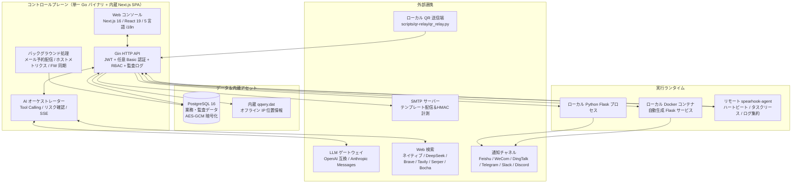

<p align="right">
  <a href="README.md">English</a> · <a href="README.zh.md">简体中文</a> · <a href="README.zh-TW.md">繁體中文</a> · <b>日本語</b> · <a href="README.ko.md">한국어</a>
</p>

<div align="center">
  <picture>
    <source media="(prefers-color-scheme: dark)" srcset="assets/readme/logo-dark.svg" />
    <source media="(prefers-color-scheme: light)" srcset="assets/readme/logo.svg" />
    
  </picture>

  <h1>Spearhook</h1>

  <p>
    
    
    
    
    
    
    
  </p>

  <p>認可されたセキュリティ意識訓練・レッドチーム演習向けの統合セルフホスト型コントロールプレーン：単一 Go バイナリ、組み込み Next.js コンソール、分散型軽量 Agent、AI 対話オーケストレーションを搭載。</p>

  <p>
    <a href="https://spearhook.pages.dev/"><strong>ライブデモ</strong></a> ·
    <a href="#法的通知">法的通知</a> ·
    <a href="#概要">概要</a> ·
    <a href="#主な機能">主な機能</a> ·
    <a href="#アーキテクチャ">アーキテクチャ</a> ·
    <a href="#クイックスタート">クイックスタート</a> ·
    <a href="#リモート-agent">リモート Agent</a> ·
    <a href="#コンソール">コンソール</a> ·
    <a href="#よくある質問faq">FAQ</a> ·
    <a href="#詳細ドキュメント">ドキュメント</a>
  </p>
</div>

---

## 法的通知

> [!WARNING]
> **認可された利用のみ**：Spearhook は**明示的な書面による認可を得た**企業向けセキュリティ意識訓練、防御検証、およびレッドチーム演習のみを目的としています。適用されるすべての法令を遵守し、無許可のテストや不正行為には絶対に使用しないでください。利用に関する一切の責任は利用者が負うものとします。

---

## 概要

Spearhook は、認可されたセキュリティ演習のライフサイクル全体（**公開情報の収集、ランディングページのテンプレート作成、マルチノード配信、メール配信と計測、イベント収集、リアルタイム通知**）を単一のコントロールプレーンに統合し、制御された AI ツール呼び出し（Tool Calling）によって運用負荷を軽減します。

### 設計の特徴

- **単一バイナリ配布**：Next.js の静的エクスポート（`frontend/dist`）、オフライン IP 位置情報 DB（`assets/qqwry.dat`）、および QR リレー用スクリプト一式を `go:embed` で Go 実行ファイルに直接同梱します。
- **制御面と実行面の分離**：プロジェクトはコントロールプレーン上のローカル Docker コンテナまたは Flask プロセスで実行できるほか、複数のリモート `spearhook-agent` ノードへ分散配備してログを集約できます。
- **制御された AI ネイティブ運用**：内蔵チャットアシスタントはホワイトリスト登録されたプラットフォームツールのみを実行し、メール一斉送信やデータエクスポートなどの破壊的操作は必ず人間の明示的な確認を挟みます。
- **組み込みのセキュリティガバナンス**：`admin` / `operator` のロール分離、機密情報・レコードの AES-GCM 保存時暗号化、追記専用で削除不可の監査ログ、アプリ層＋Linux ファイアウォール二層の IP ブラックリストを提供します。

### 技術スタック

| レイヤー | 主な技術 |
| --- | --- |
| コントロールプレーン | Go 1.24, Gin, GORM, PostgreSQL 16, JWT, AES-GCM, chromedp, Docker SDK, gopsutil |
| Web コンソール | Next.js 16（静的エクスポート）, React 19, TypeScript 5, Tailwind CSS, Radix UI, Zustand, Recharts, i18next |
| 分散 Agent | 独立した静的 Go バイナリ（`cmd/spearhook-agent`）、外部ランタイム不要 |
| ページランタイム | Python 3 + Flask + Flask-CORS（ローカルプロセスまたは Docker コンテナ） |
| QR リレークライアント | Python 3 + `mss` + `Pillow` + `pyzbar` + `requests` |

### ディレクトリ構成

```text
spearhook_v2/
├── main.go                    # コントロールプレーン起動点（起動チェック、DB 移行、API、静的フロント配信）
├── config/                    # config.yaml 読み込み、セキュリティ検査、PostgreSQL 接続プール
├── models/                    # GORM モデル定義と自動マイグレーション（30+ テーブル）
├── handlers/                  # REST API、SSE ストリーム、AI チャット、プロジェクト/メール/Agent/QR 処理
├── middleware/                # JWT 認証、Basic 認証、IP ブラックリスト、監査ログミドルウェア
├── platform/                  # デプロイ制御、Docker ビルド、Agent タスクキュー、ホストメトリクス
├── chattools/                 # AI ツールレジストリ、リスク確認ポリシー、System Prompt、Playbook
├── utils/                     # AES-GCM 暗号化、HTML 取得/書換、HMAC メール計測、LLM/検索クライアント
├── audit/                     # 追記専用の監査ログライター
├── cmd/
│   ├── spearhook-agent/       # 分散型軽量実行エージェント
│   ├── generate-encryption-key/ # 256-bit 暗号鍵生成 CLI
│   ├── reset-password/        # 管理者パスワード再設定 CLI
│   └── migrate-db/            # SQLite → PostgreSQL 一括移行 CLI
├── frontend/                  # Next.js 16 + React 19 コンソール（出力先：frontend/dist）
├── scripts/
│   ├── setup.sh               # Go 開発環境セットアップ
│   ├── build-all.sh           # フロントビルド＋マルチプラットフォーム一括ビルド
│   ├── deploy.sh              # SSH ワンコマンドデプロイ（binary / docker）
│   └── qr-relay/              # ローカル QR スクリーンキャプチャ＆送信クライアント
├── assets/                    # 同梱オフライン IP DB（qqwry.dat）＆ロゴ素材
├── docs/                      # アーキテクチャ・デプロイ・プレースホルダー詳細ガイド
├── Dockerfile                 # マルチステージビルド（Node 22 → Go 1.24 → Alpine 3.20 + Chromium + Python/Flask）
├── docker-compose.yml         # PostgreSQL 16 + Spearhook 構成ファイル
├── config.yaml.example        # コントロールプレーン設定テンプレート
└── agent.yaml.example         # リモート Agent 設定テンプレート
```

---

## 主な機能

- **AI アシスタント（`/chat`）**
  - 空セッション向けのプリセット Playbook と SSE ストリーミング応答を搭載。
  - **読み取り**（自動実行）、**書き込み**（プラットフォーム経由で実行）、**高リスク**（`send_mail_campaign` / `export_credentials` は実行前に人間が確認）の 3 段階リスク制御と、レート制限・日次上限・長文セッション自動要約・トークン使用量集計を備えます。
- **ページライブラリ（`/workbench/page-builder`）**
  - 静的取得に加え、SPA ページはヘッドレス Chromium（`chromedp`）で自動レンダリング取得。
  - ローカル HTML アップロード（最大 30 MB）と AI によるフォーム・アセット書き換え（OpenAI 互換 / Anthropic Messages 対応、SSE 進捗通知）、ビルド時のプレースホルダー自動置換（`{{SUBMIT_URL}}`、`{{REDIRECT_URL}}`、`{{QR_RELAY_URL}}`、`{{QR_RELAY_IMG}}`）をサポート。
- **プロジェクト管理（`/projects`）**
  - **ローカル Docker**、**ローカル Flask**、**リモート Agent**（ノードごとに `20000–30000` から空きポートを自動割当）の 3 モードに対応。
  - TLS 証明書マウント、リアルタイムログ、ヘルスチェック、追記専用暗号化イベント（`CredentialSubmissionEvent`）のアカウント／試行別集計、オフライン IP 位置情報およびメールキャンペーン帰属をサポート。
- **メール演習＆計測（`/workbench/mail`、`/smtp-services`）**
  - 暗号化保存された SMTP プロファイルと再利用テンプレートにより、即時または予約一斉配信が可能。
  - 受信者ごとの変数展開（`{{email}}`、`{{sig}}`、`{{v}}`、`{{click_url}}`、`{{open_pixel}}`、`{{landing_url}}`）、キャンペーン固有の計測エンドポイント、HMAC-SHA256 による開封・クリック・送信の計測、リダイレクト許可ホスト検証を提供。
- **通知チャネル（`/robots`）**
  - **Feishu / WeCom / DingTalk / Telegram / Slack / Discord** の 6 種類の Webhook ボットに対応（多言語通知、疎通テスト、配信ログ記録）。
- **リアルタイム QR リレー（`/workbench/qr-phishing`）**
  - 固定公開 URL（`/q/:slug`）で最新 QR 画像を配信し、ローカル Python クライアント（`scripts/qr-relay/qr_relay.py`）からフレームとハートビートを受信。SSE によるオンライン／期限切れ監視、過去フレーム昇格、トークン／Slug ローテーションに対応。
- **公開情報収集（`/workbench/info-gathering`）**
  - AI ネイティブ Web 検索、または複数プロバイダ（**DeepSeek Search / Brave / Tavily / Serper / Bocha**）の並列検索を組み合わせて公開連絡先を非同期収集・重複排除します。
- **リモート Agent（`/agents`）**
  - 単体バイナリ `spearhook-agent` により、トークン登録・ハートビート・タスクリース・ログ集中送信を実現。1 プロジェクト対複数 Agent、1 Agent 対複数プロジェクトの両方に対応。
- **認証・監査・運用監視（`/`、`/users`、`/audit-logs`、`/ip-blacklist`）**
  - JWT 認証＋任意の HTTP Basic 認証、ロール分離、削除不可の監査ログ、24 時間ホスト CPU/メモリ/ディスク監視（30 秒間隔）、日次ローテーションアクセスログ、Gin ミドルウェア＋Linux `iptables` 二層の **IP ブラックリスト**。
  - UI は 5 言語（**English / 简体中文 / 繁體中文 / 日本語 / 한국어**）および静的デモモードに対応。

---

## アーキテクチャ



---

## クイックスタート

### 前提環境

- **Docker Compose（推奨）**：Docker Engine 20.10+ および Docker Compose v2
- **ソースビルド／開発**：
  - Go `1.24+`、Node.js `22+`、PostgreSQL `16+`（コントロールプレーンは PostgreSQL 必須）
  - 任意：Chromium（SPA レンダリング用）、Python 3 + `flask`/`flask-cors`/`requests`（ローカル Flask 用）、Docker Daemon（ローカル Docker 用）

### 方法 1：Docker Compose（推奨）

1. **設定ファイルの作成とシークレット変更**

```bash
cp config.yaml.example config.yaml
# 256-bit 暗号鍵を生成する場合：
go run ./cmd/generate-encryption-key
```

`config.yaml` の `security.*` に含まれるサンプル値をすべて強力なランダム文字列へ変更してください。

2. **`.env` を作成して起動**

```env
POSTGRES_DB=spearhook
POSTGRES_USER=spearhook
POSTGRES_PASSWORD=強力なランダムパスワードに変更
TZ=Asia/Tokyo
```

```bash
docker compose up -d --build
```

3. **初期管理者パスワードの確認**

初回起動時に `admin` ユーザーが作成され、ランダムパスワードが `./data/admin_password.txt`（`0600`）へ保存されます：

```bash
cat ./data/admin_password.txt
```

ブラウザで `http://<サーバーIP>:8000` を開きます。`platform_basic_auth_enabled: true`（既定）の場合、先にブラウザの Basic 認証ダイアログで同じ `admin` とパスワードを入力してください。ログイン後はパスワードを変更し、`admin_password.txt` を削除することを推奨します。

### 方法 2：ソースからローカル開発

```bash
# 1. PostgreSQL DSN とシークレットを config.yaml に設定
cp config.yaml.example config.yaml

# 2. go:embed 用にフロントエンドを最低 1 回ビルド
cd frontend && npm ci && npm run build && cd ..

# 3. コントロールプレーン起動（:8000 で待機）
go run .

# 4. 任意：フロントエンド開発サーバー（:8081、HMR 有効）
cd frontend && npm run dev
```

ヘルスチェック：`GET /healthz`（生存）および `GET /readyz`（DB 接続確認）。

### 方法 3：クロスビルド＆SSH ワンコマンドデプロイ

```bash
# フロント＋全プラットフォーム向けバイナリ（制御面 & Agent）を release/ へビルド
./scripts/build-all.sh

# SSH デプロイ（バイナリ + systemd モード）
DB_DSN='host=127.0.0.1 port=5432 user=spearhook password=xxx dbname=spearhook sslmode=disable' \
./scripts/deploy.sh binary <ホストIP> root 22

# SSH デプロイ（Docker イメージモード）
DB_DSN='host=127.0.0.1 port=5432 user=spearhook password=xxx dbname=spearhook sslmode=disable' \
INSTALL_DOCKER=1 ./scripts/deploy.sh docker <ホストIP> root 22
```

### 初回ログイン後の標準ワークフロー

1. **システム設定**：**システム → AI 設定** で LLM を登録・テストし、必要に応じて **検索設定** と **メール追跡**（公開 `public_base_url` およびリダイレクト許可ホスト）を設定します。
2. **配信・通知チャネル登録**：**SMTP サービス** と **通知ボット** を登録・疎通確認します。
3. **ページ準備**：**ワークベンチ → ページビルダー** で対象 URL を取得、または HTML をアップロードして AI 書換え・保存します。
4. **プロジェクト作成・起動**：**プロジェクト** で実行モード（ローカル Docker / ローカル Flask / リモート Agent）を選び、通知ボットや QR リレーを紐付けます。
5. **演習実行と振り返り**：メールキャンペーンや QR リレーを開始（`/chat` からの一括指示も可能）し、結果・ダッシュボード・監査ログを確認します。

### 本番運用時の注意点とリバースプロキシ

- **非対話環境（Docker / systemd）では既定シークレットを必ず変更**：`security.*` が未設定またはサンプル値のままだと起動確認プロンプトが発生し、TTY のない環境では自動終了します。
- **ローカル Docker モードには `python:3.9-slim` が必要**：閉域網などでは事前に `docker pull python:3.9-slim` を実行してください。
- **リバースプロキシで SSE バッファリングを無効化**：AI チャット・ページ取得・QR 状態監視は SSE を使用します。Nginx 設定例：
  ```nginx
  location / {
      proxy_pass http://127.0.0.1:8000;
      proxy_http_version 1.1;
      proxy_set_header Host $host;
      proxy_set_header X-Real-IP $remote_addr;
      proxy_set_header X-Forwarded-For $proxy_add_x_forwarded_for;
      proxy_set_header X-Forwarded-Proto $scheme;
      proxy_buffering off;
      proxy_cache off;
      proxy_read_timeout 300s;
  }
  ```
- **macOS / Windows での Docker Compose**：`docker-compose.yml` は Linux 向けに `network_mode: host` を採用しています。Docker Desktop では `ports: ["8000:8000"]` を明示し、`SPEARHOOK_DB_DSN` の `host` を `postgres` に変更するか、ソース実行をご利用ください。
- **`security.encryption_key` の厳重保管**：DB 暗号化フィールドの復号に必須のため、**初期化後は安易に変更せず**オフラインでバックアップしてください。

### 主要設定（`config.yaml`）

AI・検索・メール追跡設定は初回起動後にコンソールから動的変更できます。`config.yaml` では起動時パラメータを管理します：

| 設定キー | 説明 | 環境変数上書き |
| --- | --- | --- |
| `server.port` | HTTP 待受ポート（既定 `8000`） | — |
| `server.gin_mode` | `debug` / `release` / `test` | — |
| `database.dsn` | **必須** PostgreSQL 接続文字列 | `SPEARHOOK_DB_DSN` |
| `database.path` | ログ・成果物・初期パスワードの基準データパス | `SPEARHOOK_DB_PATH` |
| `security.encryption_key` | AES-GCM マスター鍵（**初期化後の変更厳禁**） | — |
| `security.jwt_secret` | JWT 署名鍵 | — |
| `security.container_secret` | 生成された Flask ランタイムがトークン取得に使う共有鍵 | — |
| `security.agent_registration_token` | Agent 初回登録トークン（空時は `container_secret` を利用） | — |
| `security.platform_basic_auth_enabled` | 外周 HTTP Basic 認証の有効化（既定 `true`） | — |
| `chat.*` | 任意：`max_tool_rounds`（`8`）、`rate_min_interval_ms`（`800`）、`daily_limit`（`200`）、`max_history_messages`（`40`） | — |
| `search.*` | 任意：初回起動時に DB へシードする検索プロバイダ設定 | — |

> [!TIP]
> SPA ページのヘッドレス取得で Chromium が自動検出されない場合は、`CHROME_PATH` 環境変数でバイナリパスを指定してください（Docker イメージでは `/usr/bin/chromium` 設定済み）。

---

## リモート Agent

### 1. `spearhook-agent` のデプロイ

各実行ホストに `agent.yaml`（[agent.yaml.example](agent.yaml.example) 参照）を配置します：

```yaml
server_url: http://<コントロールプレーン>:8000
registration_token: <security.agent_registration_token と一致>
name: node-jp-01                  # 任意（既定はホスト名）
work_dir: ./data/agent            # state.json と pending-logs.json を保存
bind_host: 0.0.0.0
advertise_host: <公開IPまたはドメイン>
heartbeat_interval: 30s
poll_interval: 3s
tags: ["edge", "region-a"]
```

起動コマンド：

```bash
./spearhook-agent -config agent.yaml
```

- **状態保存とログバッファ**：初回起動時に登録を完了し、`work_dir/state.json` へ長期トークンを保存します。コントロールプレーン疎通不可時はアクセスログを `pending-logs.json` に退避し、復旧後に再送します。
- **送信のリアルタイム転送**：フォーム送信はローカルキューを持たずリアルタイムで転送されます。コントロールプレーン到達不可時は HTTP `502` を返します。

### 2. ローカル QR リレー送信端（`scripts/qr-relay`）

コンソールの **ワークベンチ → QR 中継** でチャネルを作成し、アップロードトークンを取得して実行します（ZIP ダウンロード対応）：

```bash
cd scripts/qr-relay
cp config.example.yaml config.yaml
# platform_url と upload_token を設定

pip install -r requirements.txt
# macOS は追加で必要：brew install zbar
# Windows：pip install --only-binary=:all: -r requirements.txt（VC++ 2013 x64 ランタイム必須）

# 任意：画面キャプチャ領域（物理ピクセル）を対話的に選択
python3 qr_relay.py --pick-region -c config.yaml

# 継続キャプチャ・重複除外アップロード・期限切れハートビートを開始
python3 qr_relay.py -c config.yaml
```

### 3. 組み込み管理 CLI（`cmd/`）

- **256-bit 暗号鍵生成**：`go run ./cmd/generate-encryption-key`
- **管理者パスワード再設定**（20 文字の強パスワードを `data/admin_password.txt` へ出力）：`go run ./cmd/reset-password`
- **旧 SQLite から PostgreSQL へのデータ移行**（ID・暗号文を保持、まず `-dry-run` 推奨）：
  ```bash
  go run ./cmd/migrate-db -sqlite ./data/fishing.db -postgres "host=127.0.0.1 port=5432 user=spearhook password=xxx dbname=spearhook sslmode=disable" -dry-run
  ```

---

## コンソール

組み込み Next.js 16 SPA は API と同一ポートで以下の画面を提供します：

- `/` — ダッシュボード（稼働プロジェクト、オンライン Agent、当日イベント、24 時間ホストリソース推移）
- `/chat` — AI アシスタント（Playbook ＆ 高リスク操作の確認フロー）
- `/workbench/page-builder`、`/workbench/mail`、`/workbench/info-gathering`、`/workbench/qr-phishing` — 演習ワークベンチ
- `/projects`、`/agents`、`/robots`、`/smtp-services`、`/ip-blacklist` — プロジェクト・ノード・運用リソース
- `/users`、`/audit-logs`、`/ai-settings`、`/search-settings`、`/mail-tracking` — 管理者設定と監査ログ

### テストと静的デモビルド

```bash
# Go バックエンドテスト
go test ./...

# フロントエンドヘルパー＆i18n テスト
cd frontend && npm run test:helpers

# 読み取り専用静的デモのビルド（出力先：frontend/demo-dist）
cd frontend && npm run build:demo:root
```

読み取り専用ライブデモ：**[https://spearhook.pages.dev/](https://spearhook.pages.dev/)**（モックデータのみ、バックエンド不要）。

---

## よくある質問（FAQ）

<details>
<summary><strong>Q1：アクセス時にブラウザの Basic 認証ダイアログが表示されます。</strong></summary>

外周防御として `security.platform_basic_auth_enabled: true` が既定で有効になっています。DB 上のコンソールアカウント（初回は `admin` と `data/admin_password.txt` のパスワード）で通過できます。不要な場合は `false` に変更して再起動してください。

</details>

<details>
<summary><strong>Q2：管理者パスワードを忘れた場合は？</strong></summary>

リポジトリ直下で `go run ./cmd/reset-password` を実行すると、`admin` の新しい 20 文字パスワードが生成され `data/admin_password.txt` に保存されます。ログイン後に削除してください。

</details>

<details>
<summary><strong>Q3：Docker / systemd で <code>Security configuration warning</code> が出て即終了します。</strong></summary>

`config.yaml` の `security.*` に空欄またはサンプル既定値が残っています。非対話環境では確認入力ができず安全のため停止します。すべてのシークレットをランダム文字列に置き換えて再起動してください。

</details>

<details>
<summary><strong>Q4：SPA ページの取得時に Chromium エラーが発生します。</strong></summary>

JS レンダリングにはヘッドレス Chromium（`chromedp`）が必要です。Docker イメージには `/usr/bin/chromium` が同梱済みですが、ネイティブ環境では Chromium/Chrome を導入し `CHROME_PATH` を設定してください。

</details>

<details>
<summary><strong>Q5：メール追跡リンクが <code>127.0.0.1</code> になる、またはリダイレクトが拒否されます。</strong></summary>

コンソールの **システム → メール追跡** で、外部から到達可能な `public_base_url` を設定し、ランディングページのホスト名を `allow_redirect_hosts` に追加してください。

</details>

<details>
<summary><strong>Q6：<code>security.encryption_key</code> を変更したら既存設定が動かなくなりました。</strong></summary>

機密フィールドは `security.encryption_key` で AES-GCM 暗号化されています。元の鍵に戻すか、コンソールから該当のボット／SMTP／AI 設定を再保存してください。

</details>

---

## 詳細ドキュメント

| ドキュメント | 内容 |
| --- | --- |
| [docs/deployment.md](docs/deployment.md) | ワンコマンドデプロイ（Docker / 単一バイナリ）、アップグレード＆トラブルシュート |
| [docs/agent-deployment.md](docs/agent-deployment.md) | リモート Agent 導入：systemd、Windows サービス、リバースプロキシ |
| [docs/placeholders.ja.md](docs/placeholders.ja.md) | HTML ランディングページ・メールテンプレートのプレースホルダー一覧 |
| [docs/ai-native-architecture.md](docs/ai-native-architecture.md) | AI ネイティブオーケストレーション設計（ツール・SSE・境界制御） |
| [docs/ai-native-assessment.md](docs/ai-native-assessment.md) | AI Native 実現性評価とロードマップ |
| [docs/demo-hosting.md](docs/demo-hosting.md) | Cloudflare Pages での静的デモホスティング手順 |
| [scripts/qr-relay/README.md](scripts/qr-relay/README.md) | ローカル QR キャプチャ送信スクリプト詳細ガイド |

---

## 免責事項

Spearhook は、明示的な書面による認可を得たセキュリティ意識訓練・内部演習・防御検証のみを目的として提供されています。認可のないシステム、アカウント、または個人に対して本ソフトウェアを配備・使用することは固く禁じられています。すべての法令および組織規程の遵守は利用者の責任となります。

本プロジェクトは [MIT License](LICENSE) の下で公開されています。
