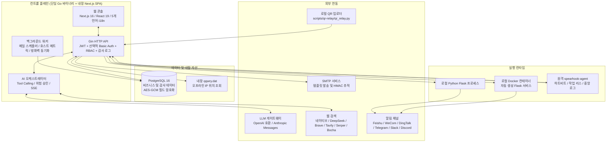

<p align="right">
  <a href="README.md">English</a> · <a href="README.zh.md">简体中文</a> · <a href="README.zh-TW.md">繁體中文</a> · <a href="README.ja.md">日本語</a> · <b>한국어</b>
</p>

<div align="center">
  <picture>
    <source media="(prefers-color-scheme: dark)" srcset="assets/readme/logo-dark.svg" />
    <source media="(prefers-color-scheme: light)" srcset="assets/readme/logo.svg" />
    
  </picture>

  <h1>Spearhook</h1>

  <p>
    
    
    
    
    
    
    
  </p>

  <p>인가된 보안 인식 훈련 및 레드팀 모의 훈련을 위한 올인원 셀프 호스팅 컨트롤 플레인: 단일 Go 바이너리, 내장 Next.js 콘솔, 분산 경량 Agent 노드, AI 대화형 오케스트레이션 엔진을 제공합니다.</p>

  <p>
    <a href="https://spearhook.pages.dev/"><strong>라이브 데모</strong></a> ·
    <a href="#법적-고지">법적 고지</a> ·
    <a href="#프로젝트-개요">개요</a> ·
    <a href="#핵심-기능">핵심 기능</a> ·
    <a href="#아키텍처">아키텍처</a> ·
    <a href="#빠른-시작">빠른 시작</a> ·
    <a href="#원격-agent">원격 Agent</a> ·
    <a href="#콘솔">콘솔</a> ·
    <a href="#자주-묻는-질문faq">FAQ</a> ·
    <a href="#상세-문서">상세 문서</a>
  </p>
</div>

---

## 법적 고지

> [!WARNING]
> **인가된 사용 전용**: Spearhook은 **명시적인 서면 인가를 받은** 기업 보안 인식 훈련, 방어 검증 및 승인된 레드팀 훈련 목적으로만 사용해야 합니다. 관련 국가 및 지역 법령을 엄격히 준수해야 하며, 무단 테스트나 불법 행위에 사용하는 것을 엄격히 금지합니다. 모든 사용 책임은 사용자 본인에게 있습니다.

---

## 프로젝트 개요

Spearhook은 인가된 보안 훈련의 전체 수명 주기(**공개 정보 수집, 랜딩 페이지 템플릿 제작, 멀티 노드 배포, 메일 발송 및 추적, 이벤트 수집, 실시간 알림**)를 단일 셀프 호스팅 컨트롤 플레인에 통합하며, 통제된 AI 도구 호출(Tool Calling)로 반복적인 운영 작업을 간소화합니다.

### 설계 특징

- **단일 바이너리 배포**: Next.js 정적 빌드(`frontend/dist`), 오프라인 IP 위치 DB(`assets/qqwry.dat`), QR 릴레이 클라이언트 스크립트를 `go:embed`로 단일 Go 바이너리에 내장합니다.
- **컨트롤 플레인과 실행 환경 분리**: 프로젝트는 컨트롤 플레인 로컬의 Docker 컨테이너나 Python Flask 프로세스로 실행할 수 있으며, 원격 `spearhook-agent` 노드로 분산 배포하여 로그와 이벤트를 중앙 수집할 수 있습니다.
- **통제된 AI 네이티브 오케스트레이션**: 내장 채팅 어시스턴트는 화이트리스트에 등록된 플랫폼 도구만 호출하며, 메일 일괄 발송이나 기록 내보내기 같은 고위험 작업은 반드시 운영자의 명시적 승인을 거칩니다.
- **기본 내장 보안 거버넌스**: `admin` / `operator` 역할 분리, 민감 키 및 기록의 AES-GCM 저장 암호화, 추가 전용 불변 감사 로그, 애플리케이션 및 Linux 호스트 방화벽 이중 IP 블랙리스트를 지원합니다.

### 기술 스택

| 계층 | 주요 기술 |
| --- | --- |
| 컨트롤 플레인 | Go 1.24, Gin, GORM, PostgreSQL 16, JWT, AES-GCM, chromedp, Docker SDK, gopsutil |
| 웹 콘솔 | Next.js 16 (정적 내보내기), React 19, TypeScript 5, Tailwind CSS, Radix UI, Zustand, Recharts, i18next |
| 분산 Agent | 독립 실행형 정적 Go 바이너리(`cmd/spearhook-agent`), 외부 런타임 불필요 |
| 페이지 런타임 | Python 3 + Flask + Flask-CORS (로컬 프로세스 또는 Docker 컨테이너) |
| QR 릴레이 클라이언트 | Python 3 + `mss` + `Pillow` + `pyzbar` + `requests` |

### 디렉터리 구조

```text
spearhook_v2/
├── main.go                    # 컨트롤 플레인 진입점 (시작 점검, DB 마이그레이션, API, 내장 SPA)
├── config/                    # config.yaml 로더, 보안 설정 검증, PostgreSQL 커넥션 풀
├── models/                    # GORM 데이터 모델 및 자동 마이그레이션 (30+ 테이블)
├── handlers/                  # REST API, SSE 스트림, AI 채팅, 프로젝트/메일/Agent/QR 핸들러
├── middleware/                # JWT 인증, 선택적 Basic Auth, IP 블랙리스트 차단, 감사 로그
├── platform/                  # 배포 오케스트레이션, Docker 빌드, Agent 작업 큐, 호스트 메트릭
├── chattools/                 # AI 도구 레지스트리, 위험 등급 승인 정책, System Prompt, Playbook
├── utils/                     # AES-GCM 암호화, HTML 수집/재작성, HMAC 메일 추적, LLM/검색 클라이언트
├── audit/                     # 추가 전용 감사 로그 기록기
├── cmd/
│   ├── spearhook-agent/       # 경량 분산 실행 에이전트
│   ├── generate-encryption-key/ # 256-bit 랜덤 암호화 키 생성 도구
│   ├── reset-password/        # 관리자 강력 비밀번호 초기화 도구
│   └── migrate-db/            # 기존 SQLite → PostgreSQL 마이그레이션 도구
├── frontend/                  # Next.js 16 + React 19 콘솔 (빌드 출력: frontend/dist)
├── scripts/
│   ├── setup.sh               # Go 개발 환경 초기화 스크립트
│   ├── build-all.sh           # 프론트엔드 빌드 + 멀티 플랫폼 크로스 컴파일
│   ├── deploy.sh              # SSH 원클릭 배포 스크립트 (binary / docker 모드)
│   └── qr-relay/              # 로컬 QR 화면 캡처 및 업로드 클라이언트
├── assets/                    # 내장 오프라인 IP DB(qqwry.dat) 및 로고 리소스
├── docs/                      # 아키텍처, 배포, 플레이스홀더, 데모 호스팅 가이드
├── Dockerfile                 # 멀티 스테이지 이미지 (Node 22 → Go 1.24 → Alpine 3.20 + Chromium + Python/Flask)
├── docker-compose.yml         # PostgreSQL 16 + Spearhook 스택 구성
├── config.yaml.example        # 컨트롤 플레인 설정 템플릿
└── agent.yaml.example         # 원격 Agent 설정 템플릿
```

---

## 핵심 기능

- **AI 어시스턴트 (`/chat`)**
  - 빈 세션용 프리셋 Playbook과 SSE 토큰 스트리밍 응답을 제공합니다.
  - **읽기**(자동 실행), **쓰기**(플랫폼 워크플로 실행), **고위험**(`send_mail_campaign`, `export_credentials` — 사용자 명시적 승인 필수)의 3단계 위험 제어와 호출 횟수/요청 빈도/일일 한도 제한, 긴 세션 자동 요약, 프로필별 토큰 사용량 집계를 지원합니다.
- **페이지 라이브러리 (`/workbench/page-builder`)**
  - 정적 HTML 수집 후 클라이언트 렌더링(SPA) 페이지가 감지되면 헤드리스 Chromium(`chromedp`)으로 자동 폴백합니다.
  - 로컬 HTML 업로드(최대 30 MB) 및 AI 기반 폼/정적 리소스 재작성(OpenAI 호환 / Anthropic Messages 지원, SSE 진행률 표시), 프로젝트 빌드 시 플레이스홀더 자동 치환(`{{SUBMIT_URL}}`, `{{REDIRECT_URL}}`, `{{QR_RELAY_URL}}`, `{{QR_RELAY_IMG}}`)을 지원합니다.
- **프로젝트 관리 (`/projects`)**
  - **로컬 Docker**, **로컬 Flask**, **원격 Agent**(노드별 `20000–30000` 포트 자동 할당)의 3가지 실행 모드를 지원합니다.
  - TLS 인증서 마운트, 실시간 로그, 헬스 체크, 추가 전용 암호화 이벤트(`CredentialSubmissionEvent`) 기반 계정/시도별 집계, 오프라인 IP 지역 조회 및 메일 캠페인 귀속을 제공합니다.
- **메일 훈련 및 추적 (`/workbench/mail`, `/smtp-services`)**
  - 암호화 저장되는 SMTP 프로필과 재사용 가능한 템플릿으로 즉시 발송 및 예약 발송을 지원합니다.
  - 수신자별 변수 치환(`{{email}}`, `{{sig}}`, `{{v}}`, `{{click_url}}`, `{{open_pixel}}`, `{{landing_url}}`), 캠페인별 고유 추적 경로, HMAC-SHA256 기반 열람/클릭/제출 추적 및 리다이렉트 허용 호스트 검증을 제공합니다.
- **알림 채널 (`/robots`)**
  - **Feishu, WeCom, DingTalk, Telegram, Slack, Discord** 6종 웹훅 봇을 지원하며 다국어 알림, 연결 테스트, 요청/응답 발송 로그를 제공합니다.
- **실시간 QR 릴레이 (`/workbench/qr-phishing`)**
  - 고정 공개 URL(`/q/:slug`)로 최신 QR 이미지를 제공하며 로컬 Python 캡처 스크립트(`scripts/qr-relay/qr_relay.py`)로부터 프레임과 하트비트를 수신합니다. SSE 실시간 상태 모니터링, 이전 프레임 복원, 토큰/Slug 즉시 로테이션을 지원합니다.
- **공개 정보 수집 (`/workbench/info-gathering`)**
  - AI 네이티브 웹 검색 또는 다중 검색 엔진(**DeepSeek Search, Brave, Tavily, Serper, Bocha**) 병렬 검색을 결합하여 이메일, 전화번호 및 출처를 비동기 수집 및 중복 제거합니다.
- **원격 Agent (`/agents`)**
  - 독립 바이너리 `spearhook-agent`로 토큰 등록, 하트비트, 작업 리스, 중앙 로그 수집을 수행합니다. 단일 프로젝트의 다중 노드 배포와 단일 노드의 다중 프로젝트 호스팅을 모두 지원합니다.
- **인증·감사·보안 운영 (`/`, `/users`, `/audit-logs`, `/ip-blacklist`)**
  - JWT 인증 + 선택적 HTTP Basic Auth, 역할 분리, 삭제 불가 감사 로그, 24시간 호스트 CPU/메모리/디스크 추세(30초 간격 수집), 일별 회전 액세스 로그, Gin 미들웨어 + Linux `iptables` 이중 **IP 블랙리스트**를 제공합니다.

---

## 아키텍처



---

## 빠른 시작

### 사전 요구 사항

- **Docker Compose (권장)**: Docker Engine 20.10+ 및 Docker Compose v2
- **소스 실행 / 개발**:
  - Go `1.24+`, Node.js `22+`, PostgreSQL `16+` (컨트롤 플레인은 PostgreSQL 필수)
  - 선택: Chromium (SPA 렌더링 수집용), Python 3 + `flask`/`flask-cors`/`requests` (로컬 Flask 모드), Docker Daemon (로컬 Docker 모드)

### 방법 1: Docker Compose 원클릭 실행 (권장)

1. **설정 파일 생성 및 기본 시크릿 교체**

```bash
cp config.yaml.example config.yaml
# 256-bit 암호화 키 생성:
go run ./cmd/generate-encryption-key
```

`config.yaml`의 `security.*` 항목에 있는 모든 예제 값을 강력한 랜덤 문자열로 변경하세요.

2. **`.env` 파일 작성 및 실행**

```env
POSTGRES_DB=spearhook
POSTGRES_USER=spearhook
POSTGRES_PASSWORD=강력한_랜덤_비밀번호_입력
TZ=Asia/Seoul
```

```bash
docker compose up -d --build
```

3. **초기 관리자 비밀번호 확인**

최초 실행 시 `admin` 계정이 생성되며 랜덤 초기 비밀번호가 `./data/admin_password.txt`(`0600`)에 저장됩니다:

```bash
cat ./data/admin_password.txt
```

브라우저에서 `http://<서버IP>:8000`에 접속합니다. `platform_basic_auth_enabled: true`(기본값)인 경우 브라우저의 Basic Auth 창에서 동일한 `admin` 계정과 초기 비밀번호를 입력하면 로그인 화면으로 이동합니다. 로그인 후 비밀번호를 변경하고 `admin_password.txt` 파일을 삭제하세요.

### 방법 2: 소스 코드 로컬 개발

```bash
# 1. config.yaml에 PostgreSQL DSN과 보안 키 설정
cp config.yaml.example config.yaml

# 2. go:embed용 프론트엔드 1회 빌드
cd frontend && npm ci && npm run build && cd ..

# 3. 컨트롤 플레인 실행 (기본 :8000)
go run .

# 4. 선택: Next.js 개발 서버 실행 (:8081, HMR 지원)
cd frontend && npm run dev
```

헬스 체크 엔드포인트: `GET /healthz`(생존) 및 `GET /readyz`(DB 준비 상태).

### 방법 3: 크로스 플랫폼 빌드 및 SSH 배포

```bash
# 프론트엔드 + 전 플랫폼(Linux/macOS/Windows) 제어면 & Agent 바이너리 빌드 (release/)
./scripts/build-all.sh

# SSH 원클릭 배포 (바이너리 + systemd 모드)
DB_DSN='host=127.0.0.1 port=5432 user=spearhook password=xxx dbname=spearhook sslmode=disable' \
./scripts/deploy.sh binary <호스트IP> root 22

# SSH 원클릭 배포 (Docker 이미지 모드)
DB_DSN='host=127.0.0.1 port=5432 user=spearhook password=xxx dbname=spearhook sslmode=disable' \
INSTALL_DOCKER=1 ./scripts/deploy.sh docker <호스트IP> root 22
```

### 최초 로그인 후 표준 워크플로

1. **시스템 기본 설정**: **시스템 → AI 설정**에서 LLM 엔드포인트를 등록/테스트하고, 필요 시 **검색 설정**과 **메일 추적**(외부 접근 가능한 `public_base_url` 및 리다이렉트 허용 호스트)을 구성합니다.
2. **발송 및 알림 채널 구성**: **SMTP 서비스**와 **알림 봇**을 등록하고 연결을 테스트합니다.
3. **랜딩 페이지 준비**: **워크벤치 → 페이지 빌더**에서 대상 URL을 미러링하거나 로컬 HTML을 업로드해 AI 재작성 후 저장합니다.
4. **프로젝트 생성 및 실행**: **프로젝트**에서 실행 모드(로컬 Docker / 로컬 Flask / 원격 Agent)를 선택하고 알림 봇이나 QR 릴레이를 연결합니다.
5. **훈련 수행 및 분석**: 메일 캠페인이나 QR 릴레이를 시작(`/chat`에서 자연어로 일괄 실행 가능)하고 프로젝트 상세, 대시보드, 감사 로그에서 결과를 검토합니다.

### 운영 배포 주의 사항 및 리버스 프록시

- **비대화형 환경(Docker / systemd)에서는 기본 시크릿 필수 변경**: `security.*`가 비어 있거나 예제 값이면 확인 프롬프트가 출력되며, TTY가 없는 환경에서는 보안상 즉시 종료됩니다.
- **로컬 Docker 모드는 `python:3.9-slim` 베이스 이미지 필요**: 폐쇄망 환경에서는 사전에 `docker pull python:3.9-slim`을 실행해 두세요.
- **리버스 프록시에서 SSE 버퍼링 비활성화**: AI 채팅, 페이지 수집, QR 상태 모니터링은 SSE를 사용합니다. Nginx 설정 예시:
  ```nginx
  location / {
      proxy_pass http://127.0.0.1:8000;
      proxy_http_version 1.1;
      proxy_set_header Host $host;
      proxy_set_header X-Real-IP $remote_addr;
      proxy_set_header X-Forwarded-For $proxy_add_x_forwarded_for;
      proxy_set_header X-Forwarded-Proto $scheme;
      proxy_buffering off;
      proxy_cache off;
      proxy_read_timeout 300s;
  }
  ```
- **macOS / Windows에서 Docker Compose 사용 시**: `docker-compose.yml`은 Linux 로컬 포트 노출을 위해 `network_mode: host`를 사용합니다. Docker Desktop에서는 `ports: ["8000:8000"]`으로 변경하고 `SPEARHOOK_DB_DSN`의 `host`를 `postgres`로 지정하거나 소스 모드로 실행하세요.
- **`security.encryption_key` 안전 보관**: 암호화된 DB 필드 복호화에 사용되므로 **초기화 후 임의로 변경하지 말고** 오프라인 백업을 보관하세요.

### 주요 설정 (`config.yaml`)

AI 프로필, 검색 엔진, 메일 추적 설정은 최초 부팅 이후 웹 콘솔에서 실시간 수정할 수 있으며, `config.yaml`은 부팅 시 필수 설정을 관리합니다:

| 설정 키 | 설명 | 환경 변수 재정의 |
| --- | --- | --- |
| `server.port` | 컨트롤 플레인 HTTP 포트 (기본 `8000`) | — |
| `server.gin_mode` | `debug` / `release` / `test` | — |
| `database.dsn` | **필수** PostgreSQL 연결 DSN | `SPEARHOOK_DB_DSN` |
| `database.path` | 로그, 아티팩트, 초기 비밀번호 저장 기준 경로 | `SPEARHOOK_DB_PATH` |
| `security.encryption_key` | AES-GCM 마스터 암호화 키 (**초기화 후 변경 금지**) | — |
| `security.jwt_secret` | JWT 서명 키 | — |
| `security.container_secret` | 생성된 Flask 런타임의 콜백 토큰 발급용 공유 시크릿 | — |
| `security.agent_registration_token` | 원격 Agent 최초 등록 토큰 (미설정 시 `container_secret` 사용) | — |
| `security.platform_basic_auth_enabled` | 외곽 HTTP Basic Auth 활성화 (기본 `true`) | — |
| `chat.*` | 선택: `max_tool_rounds`(`8`), `rate_min_interval_ms`(`800`), `daily_limit`(`200`), `max_history_messages`(`40`) | — |
| `search.*` | 선택: 최초 부팅 시 DB로 시드되는 검색 제공자 설정 | — |

> [!TIP]
> SPA 페이지 렌더링 시 Chromium 자동 탐지가 실패하면 `CHROME_PATH` 환경 변수로 실행 파일 경로를 지정하세요(Docker 이미지는 `/usr/bin/chromium` 기본 설정).

---

## 원격 Agent

### 1. `spearhook-agent` 배포

원격 실행 호스트에 `agent.yaml`([agent.yaml.example](agent.yaml.example) 참고)을 준비합니다:

```yaml
server_url: http://<컨트롤플레인>:8000
registration_token: <security.agent_registration_token과 동일>
name: node-kr-01                  # 선택 (기본값: 호스트명)
work_dir: ./data/agent            # state.json 및 pending-logs.json 저장
bind_host: 0.0.0.0
advertise_host: <공개IP_또는_도메인>
heartbeat_interval: 30s
poll_interval: 3s
tags: ["edge", "region-a"]
```

실행 명령:

```bash
./spearhook-agent -config agent.yaml
```

- **상태 및 로그 버퍼링**: 최초 실행 시 자동 등록 후 장기 토큰을 `work_dir/state.json`에 저장합니다. 컨트롤 플레인 연결이 끊기면 액세스 로그는 `pending-logs.json`에 저장되었다가 복구 시 재전송됩니다.
- **실시간 제출 프록시**: 폼 제출 데이터는 로컬 큐 없이 실시간으로 전달되며, 컨트롤 플레인에 연결할 수 없는 경우 방문자에게 HTTP `502`가 반환됩니다.

### 2. 로컬 QR 릴레이 업로더 (`scripts/qr-relay`)

콘솔 **워크벤치 → QR 릴레이**에서 채널을 생성하고 업로드 토큰을 복사해 실행합니다(콘솔에서 ZIP 다운로드 가능):

```bash
cd scripts/qr-relay
cp config.example.yaml config.yaml
# platform_url과 upload_token 설정

pip install -r requirements.txt
# macOS 추가 설치 필요: brew install zbar
# Windows: pip install --only-binary=:all: -r requirements.txt (VC++ 2013 x64 런타임 필요)

# 선택: 화면 캡처 영역(물리 픽셀) 대화형 지정
python3 qr_relay.py --pick-region -c config.yaml

# 지속 캡처, 중복 제거 업로드 및 만료 상태 하트비트 시작
python3 qr_relay.py -c config.yaml
```

### 3. 내장 관리 CLI (`cmd/`)

- **256-bit 암호화 키 생성**: `go run ./cmd/generate-encryption-key`
- **관리자 비밀번호 재설정** (20자리 강력 비밀번호를 `data/admin_password.txt`에 저장): `go run ./cmd/reset-password`
- **기존 SQLite → PostgreSQL 마이그레이션** (ID 및 암호문 보존, `-dry-run` 선행 권장):
  ```bash
  go run ./cmd/migrate-db -sqlite ./data/fishing.db -postgres "host=127.0.0.1 port=5432 user=spearhook password=xxx dbname=spearhook sslmode=disable" -dry-run
  ```

---

## 콘솔

내장 Next.js 16 SPA는 백엔드 API와 동일한 포트에서 다음 화면을 제공합니다:

- `/` — 대시보드 (실행 프로젝트, 온라인 Agent, 당일 이벤트, 24시간 호스트 리소스 추세)
- `/chat` — AI 어시스턴트 (Playbook 및 고위험 작업 승인 흐름)
- `/workbench/page-builder`, `/workbench/mail`, `/workbench/info-gathering`, `/workbench/qr-phishing` — 훈련 워크벤치
- `/projects`, `/agents`, `/robots`, `/smtp-services`, `/ip-blacklist` — 프로젝트, 노드 및 운영 리소스
- `/users`, `/audit-logs`, `/ai-settings`, `/search-settings`, `/mail-tracking` — 관리자 설정 및 감사 로그

### 테스트 및 정적 데모 빌드

```bash
# Go 백엔드 테스트 실행
go test ./...

# 프론트엔드 유틸리티 및 다국어(i18n) 테스트 실행
cd frontend && npm run test:helpers

# 읽기 전용 정적 데모 빌드 (출력: frontend/demo-dist)
cd frontend && npm run build:demo:root
```

읽기 전용 라이브 데모: **[https://spearhook.pages.dev/](https://spearhook.pages.dev/)** (모의 데이터 내장, 백엔드 불필요).

---

## 자주 묻는 질문（FAQ）

<details>
<summary><strong>Q1: 접속 시 로그인 화면 전에 브라우저 기본 인증(HTTP Basic Auth) 창이 뜹니다.</strong></summary>

외부 1차 보호를 위해 `security.platform_basic_auth_enabled: true`가 기본 활성화되어 있습니다. DB에 등록된 콘솔 계정(최초 접속 시 `admin` 및 `data/admin_password.txt`의 비밀번호)을 입력하면 됩니다. 별도 게이트웨이 인증을 사용 중이라면 `false`로 설정 후 재시작하세요.

</details>

<details>
<summary><strong>Q2: 관리자 비밀번호를 분실했을 때 어떻게 초기화하나요?</strong></summary>

프로젝트 루트에서 `go run ./cmd/reset-password`를 실행하면 `admin`의 새 20자리 비밀번호가 생성되어 `data/admin_password.txt`에 기록됩니다. 로그인 후 해당 파일을 삭제하세요.

</details>

<details>
<summary><strong>Q3: Docker / systemd에서 <code>Security configuration warning</code> 출력 후 바로 종료됩니다.</strong></summary>

`config.yaml`의 `security.*` 항목 중 비어 있거나 예제 기본값이 남아 있는 항목이 있습니다. 비대화형 환경에서는 확인 입력을 받을 수 없어 안전상 자동 종료되므로, 모든 키를 랜덤 문자열로 교체한 뒤 재시작하세요.

</details>

<details>
<summary><strong>Q4: SPA 페이지 미러링 시 Chromium 오류가 발생합니다.</strong></summary>

JS 렌더링 페이지 수집에는 헤드리스 Chromium(`chromedp`)이 필요합니다. 공식 Docker 이미지에는 `/usr/bin/chromium`이 내장되어 있으며, 직접 설치 환경에서는 Chromium/Chrome을 설치하고 `CHROME_PATH`를 지정하세요.

</details>

<details>
<summary><strong>Q5: 메일 추적 링크가 <code>127.0.0.1</code>을 가리키거나 클릭 리다이렉트가 차단됩니다.</strong></summary>

콘솔 **시스템 → 메일 추적**에서 외부 접근 가능한 `public_base_url`을 설정하고, 랜딩 페이지 호스트명을 `allow_redirect_hosts`에 추가하세요.

</details>

<details>
<summary><strong>Q6: <code>security.encryption_key</code> 변경 후 기존 봇 / SMTP / AI 설정이 동작하지 않습니다.</strong></summary>

민감 필드는 `security.encryption_key` 기반 AES-GCM으로 암호화됩니다. 기존 키로 복구하거나 콘솔에서 해당 설정을 다시 저장해 새 키로 재암호화하세요.

</details>

---

## 상세 문서

| 문서 | 설명 |
| --- | --- |
| [docs/deployment.md](docs/deployment.md) | 원클릭 배포 (Docker / 단일 바이너리), 업그레이드 및 문제 해결 |
| [docs/agent-deployment.md](docs/agent-deployment.md) | 원격 Agent 배포: systemd, Windows 서비스, 리버스 프록시 |
| [docs/placeholders.ko.md](docs/placeholders.ko.md) | HTML 랜딩 페이지 및 메일 템플릿 플레이스홀더 전체 안내 |
| [docs/ai-native-architecture.md](docs/ai-native-architecture.md) | AI 네이티브 오케스트레이션 아키텍처 (도구, SSE, 가드레일) |
| [docs/ai-native-assessment.md](docs/ai-native-assessment.md) | AI Native 타당성 평가 및 로드맵 |
| [docs/demo-hosting.md](docs/demo-hosting.md) | Cloudflare Pages 정적 데모 호스팅 가이드 |
| [scripts/qr-relay/README.md](scripts/qr-relay/README.md) | 로컬 QR 화면 캡처 업로더 상세 가이드 |

---

## 면책 조항

Spearhook은 명시적인 서면 인가를 받은 보안 인식 교육, 내부 모의 훈련 및 방어 검증 목적으로만 제공됩니다. 인가 없는 시스템, 계정 또는 개인을 대상으로 본 소프트웨어를 배포하거나 사용하는 것은 엄격히 금지되며, 모든 법령 및 조직 규정 준수 책임은 전적으로 사용자에게 있습니다.

본 프로젝트는 [MIT License](LICENSE)로 배포됩니다.
