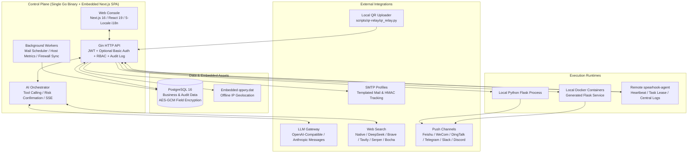

<p align="right">
  <b>English</b> · <a href="README.zh.md">简体中文</a> · <a href="README.zh-TW.md">繁體中文</a> · <a href="README.ja.md">日本語</a> · <a href="README.ko.md">한국어</a>
</p>

<div align="center">
  <picture>
    <source media="(prefers-color-scheme: dark)" srcset="assets/readme/logo-dark.svg" />
    <source media="(prefers-color-scheme: light)" srcset="assets/readme/logo.svg" />
    
  </picture>

  <h1>Spearhook</h1>

  <p>
    
    
    
    
    
    
    
  </p>

  <p>An all-in-one self-hosted control plane for authorized security awareness exercises and red-team simulations: single Go binary control plane, embedded Next.js console, distributed lightweight agents, and an AI-orchestrated operator workbench.</p>

  <p>
    <a href="https://spearhook.pages.dev/"><strong>Live Demo</strong></a> ·
    <a href="#legal-notice">Legal Notice</a> ·
    <a href="#overview">Overview</a> ·
    <a href="#features">Features</a> ·
    <a href="#architecture">Architecture</a> ·
    <a href="#quick-start">Quick Start</a> ·
    <a href="#agents">Agents</a> ·
    <a href="#console">Console</a> ·
    <a href="#faq">FAQ</a> ·
    <a href="#documentation">Docs</a>
  </p>
</div>

---

## Legal notice

> [!WARNING]
> **Authorized Use Only**: Spearhook is strictly intended for **explicitly authorized** enterprise security awareness training, defensive validation, and approved red-team exercises. You must comply with all applicable local and national laws and obtain verifiable written authorization prior to any assessment. The authors and contributors assume no liability for misuse.

---

## Overview

Spearhook unifies the full lifecycle of authorized security awareness drills—**public OSINT contact discovery, landing-page templating, multi-node deployment, email delivery & telemetry, event collection, and real-time webhook notifications**—inside a single self-hosted control plane, augmented by a tool-constrained AI operator assistant.

### Key Design Highlights

- **Single-Binary Delivery**: The Next.js static export (`frontend/dist`), offline IP geolocation database (`assets/qqwry.dat`), and QR relay script bundle are embedded directly into the Go binary via `go:embed`.
- **Decoupled Control Plane & Runtimes**: Drill projects run locally via Docker containers or isolated Python Flask processes, or distribute across remote `spearhook-agent` nodes with centralized log aggregation.
- **Controlled AI-Native Orchestration**: The built-in chat assistant acts strictly through whitelisted platform tools. Destructive actions (sending campaigns, exporting records) pause for explicit human confirmation, and all writes are recorded in immutable audit logs.
- **Built-In Governance**: Role separation (`admin` / `operator`), AES-GCM encryption at rest for secrets and records, append-only audit trails, and application + Linux host firewall IP blocking.

### Tech Stack

| Layer | Technologies |
| --- | --- |
| Control Plane | Go 1.24, Gin, GORM, PostgreSQL 16, JWT, AES-GCM, chromedp, Docker SDK, gopsutil |
| Web Console | Next.js 16 (static export), React 19, TypeScript 5, Tailwind CSS, Radix UI, Zustand, Recharts, i18next |
| Distributed Agent | Standalone static Go binary (`cmd/spearhook-agent`), zero runtime dependencies |
| Project Runtime | Python 3 + Flask + Flask-CORS (local process or Docker container) |
| QR Relay Client | Python 3 + `mss` + `Pillow` + `pyzbar` + `requests` |

### Project Structure

```text
spearhook_v2/
├── main.go                    # Control-plane entry: startup checks, DB migration, API routes, embedded SPA
├── config/                    # config.yaml loader, security checks, PostgreSQL pool setup
├── models/                    # GORM models & auto-migration (30+ core business and audit tables)
├── handlers/                  # REST APIs, SSE streams, AI chat, project/mail/agent/QR handlers
├── middleware/                # JWT auth, optional platform Basic Auth, IP blacklist guard, audit logging
├── platform/                  # Deployment orchestration, Docker builder, agent task queue, host metrics
├── chattools/                 # AI tool registry, risk confirmation policies, system prompt, playbooks
├── utils/                     # AES-GCM crypto, HTML fetch/rewrite, HMAC mail tracking, LLM/search clients, firewall sync
├── audit/                     # Immutable audit log writer
├── cmd/
│   ├── spearhook-agent/       # Lightweight distributed execution agent
│   ├── generate-encryption-key/ # 256-bit random encryption key generator
│   ├── reset-password/        # Admin strong password reset utility
│   └── migrate-db/            # One-time SQLite → PostgreSQL migration tool
├── frontend/                  # Next.js 16 + React 19 console (builds to frontend/dist)
├── scripts/
│   ├── setup.sh               # Go environment bootstrap script
│   ├── build-all.sh           # Frontend build + cross-platform Go binaries (Linux/macOS/Windows)
│   ├── deploy.sh              # One-command SSH deployment (binary or docker mode)
│   └── qr-relay/              # Local screen-capture QR frame uploader
├── assets/                    # Embedded offline IP DB (qqwry.dat) & README logos
├── docs/                      # Architecture, deployment, placeholder, and demo hosting guides
├── Dockerfile                 # Multi-stage image (Node 22 → Go 1.24 → Alpine 3.20 + Chromium + Python/Flask)
├── docker-compose.yml         # PostgreSQL 16 + Spearhook control plane stack
├── config.yaml.example        # Control-plane config template
└── agent.yaml.example         # Distributed agent config template
```

---

## Features

- **AI Assistant (`/chat`)**
  - Preset playbooks on empty sessions (e.g., clone & deploy, gather contacts, bind notify channel) with SSE token streaming.
  - Strict tool-calling risk tiers: **Read** tools run automatically; **Write** tools execute platform workflows directly; **Destructive** tools (`send_mail_campaign`, `export_credentials`) pause for explicit operator confirmation.
  - Includes configurable tool-round caps, per-user rate & daily limits, automatic context summarization for long sessions, and per-profile token usage accounting.
- **Page library (`/workbench/page-builder`)**
  - Fast static fetch with automatic fallback to headless Chromium (`chromedp`) for client-rendered SPA pages.
  - Supports uploading local HTML (up to 30 MB) and AI-assisted form/asset rewriting over SSE progress events (OpenAI-compatible `chat/completions` or Anthropic `/messages`).
  - Automatic placeholder substitution during project build/deploy: `{{SUBMIT_URL}}`, `{{REDIRECT_URL}}`, `{{QR_RELAY_URL}}`, and `{{QR_RELAY_IMG}}`.
- **Projects (`/projects`)**
  - Three execution modes: **Local Docker**, **Local Flask**, and **Distributed Agents** (automatic per-agent port allocation in `20000–30000`).
  - Supports custom routes, TLS certificate mounting, real-time logs, health checks, and append-only encrypted event projections (`CredentialSubmissionEvent` / `CredentialAccount` / `CredentialAttempt`) enriched with offline IP geolocation and mail-campaign attribution.
- **Mail (`/workbench/mail`, `/smtp-services`)**
  - Reusable SMTP profiles (passwords encrypted at rest, never returned by APIs) and reusable templates with immediate or scheduled bulk delivery.
  - Per-recipient placeholders (`{{email}}`, `{{sig}}`, `{{v}}`, `{{click_url}}`, `{{open_pixel}}`, `{{landing_url}}`), per-campaign opaque tracking endpoints, HMAC-SHA256 attribution for opens/clicks/submissions, redirect host allowlist validation, and optional HTML noise markers.
- **Push channels (`/robots`)**
  - Six webhook providers: **Feishu, WeCom, DingTalk, Telegram, Slack, and Discord**, with localized notification templates, connectivity testing, online/offline toggles, and full request/response push logs.
- **QR (`/workbench/qr-phishing`)**
  - Live QR relay channels exposing stable public image URLs (`/q/:slug`), fed by a lightweight local Python uploader (`scripts/qr-relay/qr_relay.py`).
  - Real-time SSE online/expired status monitoring, historical frame promotion, and one-click token/slug rotation.
- **Information gathering (`/workbench/info-gathering`)**
  - Asynchronous OSINT contact discovery combining AI analysis with either native model web search or parallel multi-provider search (**DeepSeek Search, Brave, Tavily, Serper, Bocha**), deduplicating emails, phone numbers, and source references.
- **Agents (`/agents`)**
  - Standalone `spearhook-agent` binaries register once with a token, send heartbeats, lease deployment tasks, and stream logs centrally. One project can target multiple agents, and one agent can host multiple projects.
- **Auth & roles (`/users`, `/audit-logs`)**
  - JWT authentication, optional perimeter HTTP Basic Auth, `admin` / `operator` roles with ownership scoping, and append-only immutable audit logs.
- **Security and operations (`/`, `/ip-blacklist`)**
  - Dashboard with 24-hour host CPU/memory/disk trends (30s sampling), daily rotating access logs, offline `qqwry.dat` IP geolocation, and **IP blacklist** enforcement at both the Gin middleware layer and Linux host firewall (`iptables`).
  - Built-in 5-language UI (**English, 简体中文, 繁體中文, 日本語, 한국어**) and static offline Demo build mode.

---

## Architecture



---

## Quick start

### Prerequisites

- **Docker Compose (Recommended)**: Docker Engine 20.10+ & Docker Compose v2
- **From Source / Development**:
  - Go `1.24+`, Node.js `22+`, PostgreSQL `16+` (PostgreSQL is required for the control plane)
  - Optional: Chromium (for SPA page rendering), Python 3 + `flask`/`flask-cors`/`requests` (for local Flask mode), Docker Daemon (for local Docker mode)

### Option 1: Docker Compose (Recommended)

1. **Create configuration and replace default secrets**

```bash
cp config.yaml.example config.yaml
# Generate a 256-bit encryption key if needed:
go run ./cmd/generate-encryption-key
```

Edit `config.yaml` and replace every placeholder value under `security.*` with strong random secrets.

2. **Create `.env` and start the stack**

```env
POSTGRES_DB=spearhook
POSTGRES_USER=spearhook
POSTGRES_PASSWORD=replace-with-strong-password
TZ=Asia/Shanghai
```

```bash
docker compose up -d --build
```

3. **Retrieve initial admin credentials**

On first boot, Spearhook creates the `admin` user and saves a random password to `./data/admin_password.txt` (`0600`):

```bash
cat ./data/admin_password.txt
```

Open `http://<server-ip>:8000`. If `platform_basic_auth_enabled: true` (default), enter the same `admin` credentials in the browser's Basic Auth prompt first. Change the password and delete `admin_password.txt` after signing in.

### Option 2: Local Development from Source

```bash
# 1. Configure config.yaml with your PostgreSQL DSN and random secrets
cp config.yaml.example config.yaml

# 2. Build the frontend once so go:embed can bundle frontend/dist
cd frontend && npm ci && npm run build && cd ..

# 3. Start the control plane (listens on :8000)
go run .

# 4. Optional: start Next.js dev server with HMR on :8081
cd frontend && npm run dev
```

Health probes: `GET /healthz` (liveness) and `GET /readyz` (database readiness).

### Option 3: Cross-Platform Build & SSH Deployment

```bash
# Build frontend + Linux/macOS/Windows binaries for both spearhook and spearhook-agent into release/
./scripts/build-all.sh

# One-command SSH deployment (binary + systemd mode)
DB_DSN='host=127.0.0.1 port=5432 user=spearhook password=xxx dbname=spearhook sslmode=disable' \
./scripts/deploy.sh binary <host> root 22

# One-command SSH deployment (Docker image mode)
DB_DSN='host=127.0.0.1 port=5432 user=spearhook password=xxx dbname=spearhook sslmode=disable' \
INSTALL_DOCKER=1 ./scripts/deploy.sh docker <host> root 22
```

### Standard End-to-End Workflow

1. **System setup**: Configure an LLM endpoint (**System → AI Settings**), optional search providers (**System → Search Settings**), and your externally reachable `public_base_url` + redirect host allowlist (**System → Mail Tracking**).
2. **Delivery & alerting**: Add an SMTP profile (**SMTP Services**) and at least one webhook bot (**Robots**).
3. **Prepare a landing page**: Mirror a target URL or upload/rewrite HTML in **Workbench → Page Builder**.
4. **Launch a project**: Create a project in **Projects**, choose Local Docker / Local Flask / Remote Agents, and bind your notification channels or QR relay.
5. **Run & review**: Launch a mail campaign or QR relay (or orchestrate the full chain from `/chat`), then review submissions, dashboard telemetry, and audit logs.

### Production Tips & Reverse Proxy

- **Replace example secrets before non-interactive startup**: If `security.*` still contains example defaults, startup prompts for confirmation and aborts automatically in non-TTY environments (Docker / systemd).
- **Pre-pull `python:3.9-slim` for local Docker mode**: Local Docker builds require `python:3.9-slim` (`utils/docker.go`). In restricted networks, run `docker pull python:3.9-slim` beforehand.
- **Disable proxy buffering for SSE**: AI chat, page mirroring, and QR status rely on Server-Sent Events. Example Nginx snippet:
  ```nginx
  location / {
      proxy_pass http://127.0.0.1:8000;
      proxy_http_version 1.1;
      proxy_set_header Host $host;
      proxy_set_header X-Real-IP $remote_addr;
      proxy_set_header X-Forwarded-For $proxy_add_x_forwarded_for;
      proxy_set_header X-Forwarded-Proto $scheme;
      proxy_buffering off;
      proxy_cache off;
      proxy_read_timeout 300s;
  }
  ```
- **Docker Compose on macOS / Windows**: `docker-compose.yml` uses `network_mode: host` for Linux local-Flask port exposure. On Docker Desktop (macOS/Windows), switch to explicit `ports: ["8000:8000"]` (and point `SPEARHOOK_DB_DSN` host to `postgres`) or run from source.
- **Protect `security.encryption_key`**: Back up this key offline and avoid rotating it carelessly, as encrypted database records depend on it.

### Core Configuration (`config.yaml`)

AI profiles, search providers, and mail tracking settings are editable live from the Web Console after initial boot; `config.yaml` manages startup settings:

| Key | Description | Env Override |
| --- | --- | --- |
| `server.port` | Control-plane HTTP listen port (default `8000`) | — |
| `server.gin_mode` | `debug` / `release` / `test` | — |
| `database.dsn` | **Required** PostgreSQL connection DSN | `SPEARHOOK_DB_DSN` |
| `database.path` | Base data directory path for logs, artifacts, and initial admin password file | `SPEARHOOK_DB_PATH` |
| `security.encryption_key` | AES-GCM master key for sensitive DB fields (**do not change arbitrarily after init**) | — |
| `security.jwt_secret` | JWT signing secret | — |
| `security.container_secret` | Shared secret used by generated Flask runtimes to obtain callback tokens | — |
| `security.agent_registration_token` | Token for first-time agent registration (falls back to `container_secret` if empty) | — |
| `security.platform_basic_auth_enabled` | Enable perimeter HTTP Basic Auth (default `true`) | — |
| `chat.*` | Optional tuning for `max_tool_rounds` (`8`), `rate_min_interval_ms` (`800`), `daily_limit` (`200`), `max_history_messages` (`40`) | — |
| `search.*` | Optional first-boot search provider seed (`auto` / `deepseek` / `brave` / `tavily` / `serper` / `bocha`) | — |

> [!TIP]
> Set `CHROME_PATH` to point to your local Chromium/Chrome binary if headless SPA cloning cannot auto-detect it (preconfigured to `/usr/bin/chromium` in the Docker image).

---

## Agents

### 1. Deploying `spearhook-agent`

Prepare `agent.yaml` (see [agent.yaml.example](agent.yaml.example)) on each remote execution host:

```yaml
server_url: http://<control-plane>:8000
registration_token: <matches security.agent_registration_token>
name: node-edge-01                # optional, defaults to hostname
work_dir: ./data/agent            # stores state.json and pending-logs.json
bind_host: 0.0.0.0                # optional listen host
advertise_host: <public-ip-or-dns>
heartbeat_interval: 30s
poll_interval: 3s
tags: ["edge", "region-a"]
```

Start the agent:

```bash
./spearhook-agent -config agent.yaml
```

- **State & logging**: On first boot, the agent registers and persists its long-lived token in `work_dir/state.json`. Access logs are buffered in `pending-logs.json` when the control plane is unreachable and flushed once connectivity returns.
- **Live submission proxying**: Form submissions are proxied directly to the control plane in real time with no local submit queue; if the control plane is unreachable, the visitor receives HTTP `502`.

### 2. Local QR Relay Uploader (`scripts/qr-relay`)

Create a relay channel in **Workbench → QR Phishing**, copy its upload token, and run the local capture script (also downloadable as a ZIP directly from the console):

```bash
cd scripts/qr-relay
cp config.example.yaml config.yaml
# Set platform_url and upload_token

pip install -r requirements.txt
# macOS also requires: brew install zbar
# Windows: pip install --only-binary=:all: -r requirements.txt (requires VC++ 2013 x64 runtime)

# Optional: interactively pick screen capture coordinates (physical pixels)
python3 qr_relay.py --pick-region -c config.yaml

# Start continuous QR capture, deduplicated upload, and expiry heartbeat
python3 qr_relay.py -c config.yaml
```

### 3. Built-In Admin CLI Tools (`cmd/`)

- **Generate 256-bit encryption key**: `go run ./cmd/generate-encryption-key`
- **Reset admin password** (writes a new 20-char password to `data/admin_password.txt`): `go run ./cmd/reset-password`
- **Migrate legacy SQLite DB to PostgreSQL** (preserves IDs & ciphertext; run with `-dry-run` first):
  ```bash
  go run ./cmd/migrate-db -sqlite ./data/fishing.db -postgres "host=127.0.0.1 port=5432 user=spearhook password=xxx dbname=spearhook sslmode=disable" -dry-run
  ```

---

## Console

The embedded Next.js 16 SPA serves all console routes on the same port as the API:

- `/` — Dashboard (running projects, online agents, active deployments, today's events, 24h host CPU/memory/disk charts)
- `/chat` — AI Assistant workbench with playbooks and confirmation flow
- `/workbench/page-builder`, `/workbench/mail`, `/workbench/info-gathering`, `/workbench/qr-phishing` — Drill workbench modules
- `/projects`, `/agents`, `/robots`, `/smtp-services`, `/ip-blacklist` — Operations & delivery resources
- `/users`, `/audit-logs`, `/ai-settings`, `/search-settings`, `/mail-tracking` — Admin system settings

### Testing & Static Demo Build

```bash
# Run Go backend tests
go test ./...

# Run frontend helper & i18n tests
cd frontend && npm run test:helpers

# Build static read-only demo bundle (output: frontend/demo-dist)
cd frontend && npm run build:demo:root
```

Read-only interactive demo: **[https://spearhook.pages.dev/](https://spearhook.pages.dev/)** (mock data only, no backend required).

---

## FAQ

<details>
<summary><strong>Q1: Why does the browser prompt for HTTP Basic Auth before showing the login page?</strong></summary>

`security.platform_basic_auth_enabled` defaults to `true` as an extra perimeter layer. It authenticates against the same database users (`admin` + the password in `data/admin_password.txt`). Set it to `false` in `config.yaml` and restart if you already protect the console behind another gateway.

</details>

<details>
<summary><strong>Q2: How do I reset a forgotten admin password?</strong></summary>

Run `go run ./cmd/reset-password` in the repository directory. It generates a new 20-character strong password for `admin` and saves it to `data/admin_password.txt`. Delete the file after signing in.

</details>

<details>
<summary><strong>Q3: Startup prints <code>Security configuration warning</code> and exits immediately in Docker / systemd?</strong></summary>

One or more keys under `security.*` in `config.yaml` are still empty or set to the example placeholder strings. In non-TTY environments the safety prompt cannot read confirmation and aborts. Replace all placeholder secrets with random strings and restart.

</details>

<details>
<summary><strong>Q4: SPA page mirroring fails with a headless Chromium error?</strong></summary>

JS-rendered pages fall back to headless Chromium (`chromedp`). The official Docker image bundles `/usr/bin/chromium`; for bare-metal installs, install Chromium/Chrome and set `CHROME_PATH` to its binary path.

</details>

<details>
<summary><strong>Q5: Mail tracking links point to <code>127.0.0.1</code> or click redirects are rejected?</strong></summary>

Open **System → Mail Tracking** in the console, set `public_base_url` to your externally reachable origin (scheme + host + port), and add your landing-page hostnames to `allow_redirect_hosts`.

</details>

<details>
<summary><strong>Q6: Existing robots / SMTP / AI profiles fail after changing <code>security.encryption_key</code>?</strong></summary>

Sensitive fields are encrypted at rest with AES-GCM using `security.encryption_key`. Changing the key prevents decrypting previously stored values—restore the original key or re-save the affected profiles in the console.

</details>

---

## Documentation

| Document | Description |
| --- | --- |
| [docs/deployment.md](docs/deployment.md) | One-command deployment (Docker / single binary), upgrades & troubleshooting |
| [docs/agent-deployment.md](docs/agent-deployment.md) | Remote agent setup: systemd, Windows service & reverse proxy |
| [docs/placeholders.en.md](docs/placeholders.en.md) | Complete HTML landing-page & email template placeholder reference |
| [docs/ai-native-architecture.md](docs/ai-native-architecture.md) | AI-native orchestration architecture (tool registry, SSE & guardrails) |
| [docs/ai-native-assessment.md](docs/ai-native-assessment.md) | AI-native feasibility assessment & roadmap |
| [docs/demo-hosting.md](docs/demo-hosting.md) | Hosting the read-only static demo on Cloudflare Pages |
| [scripts/qr-relay/README.md](scripts/qr-relay/README.md) | Local QR screen-capture uploader guide |

---

## Disclaimer

Spearhook is provided strictly for authorized security awareness exercises, internal training, and approved defensive assessments. Never deploy or operate this software against systems, accounts, or individuals without explicit written authorization. You are solely responsible for ensuring compliance with all applicable laws and organizational policies.

Released under the [MIT License](LICENSE).
