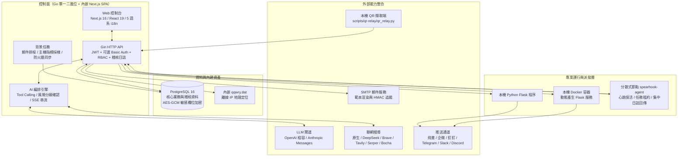

<p align="right">
  <a href="README.md">English</a> · <a href="README.zh.md">简体中文</a> · <b>繁體中文</b> · <a href="README.ja.md">日本語</a> · <a href="README.ko.md">한국어</a>
</p>

<div align="center">
  <picture>
    <source media="(prefers-color-scheme: dark)" srcset="assets/readme/logo-dark.svg" />
    <source media="(prefers-color-scheme: light)" srcset="assets/readme/logo.svg" />
    
  </picture>

  <h1>Spearhook</h1>

  <p>
    
    
    
    
    
    
    
  </p>

  <p>面向授權安全演練與資安意識評估的一體化自託管控制平台：基於 Go 單一二進位控制面、內嵌 Next.js 控制台、分散式輕量 Agent 節點以及 AI 對話式編排引擎建構。</p>

  <p>
    <a href="https://spearhook.pages.dev/"><strong>線上展示（Live Demo）</strong></a> ·
    <a href="#法律聲明">法律聲明</a> ·
    <a href="#專案簡介">專案簡介</a> ·
    <a href="#核心能力">核心能力</a> ·
    <a href="#系統架構">系統架構</a> ·
    <a href="#快速開始">快速開始</a> ·
    <a href="#遠端-agent">遠端 Agent</a> ·
    <a href="#控制台">控制台</a> ·
    <a href="#常見問題faq">FAQ</a> ·
    <a href="#進階文件索引">進階文件</a>
  </p>
</div>

---

## 法律聲明

> [!WARNING]
> **合規與授權聲明**：本專案僅供**已取得明確書面授權**的企業資安意識演練、紅藍對抗模擬與防禦驗證使用。請嚴格遵守所在國家或地區的法律法規，嚴禁將本工具用於任何未經授權的測試或非法活動。使用者須自行承擔一切使用責任。

---

## 專案簡介

Spearhook 將授權安全演練全生命週期中的**公開線索蒐集、頁面範本建構、多節點部署、郵件投遞與追蹤、事件回收與告警通知**整合至同一控制面，並透過受控的 AI 工具呼叫（Tool Calling）能力降低重複性編排成本。

### 設計特色

- **單一二進位交付**：前端經 Next.js 靜態匯出後透過 `go:embed` 直接打包進 Go 執行檔，同時內嵌離線 IP 地理定位庫（`assets/qqwry.dat`）與 QR Code 中繼用戶端腳本包。
- **控制面與執行面解耦**：演練專案既可在控制面本機以 Docker 容器或本機 Flask 程序運行，也可派發至多台異地部署的 `spearhook-agent` 節點執行，運行日誌與提交事件自動匯聚回控制面。
- **AI 原生且嚴格受控**：內建對話式維運助手，強制透過平台註冊的白名單工具執行所有讀寫操作；高風險動作（如正式群發郵件活動、匯出提交紀錄）預設暫停並要求操作員於前端明確確認。
- **開箱即用的安全治理**：支援 `admin` / `operator` 雙角色與資源歸屬隔離、AES-GCM 靜態加密儲存敏感金鑰與紀錄、僅追加不可刪除的稽核日誌，以及應用程式層與 Linux 主機防火牆雙層 IP 黑名單攔截。

### 技術棧

| 層級 | 核心技術 |
| --- | --- |
| 後端控制面 | Go 1.24、Gin、GORM、PostgreSQL 16、JWT、AES-GCM、chromedp、Docker SDK、gopsutil |
| 前端控制台 | Next.js 16（靜態匯出）、React 19、TypeScript 5、Tailwind CSS、Radix UI、Zustand、Recharts、i18next |
| 分散式節點 | Go 獨立靜態二進位（`cmd/spearhook-agent`），無外部執行期相依 |
| 落地頁執行期 | Python 3 + Flask + Flask-CORS（本機程序或 Docker 容器） |
| QR Code 擷取端 | Python 3 + `mss` + `Pillow` + `pyzbar` + `requests` |

### 目錄結構

```text
spearhook_v2/
├── main.go                    # 控制面入口：啟動自檢、資料庫遷移、API 路由與內嵌前端託管
├── config/                    # config.yaml 載入、安全項檢查、PostgreSQL 連線池初始化
├── models/                    # GORM 資料模型與自動遷移（30+ 核心業務與稽核資料表）
├── handlers/                  # REST API、SSE 事件串流、AI 對話、專案/郵件/Agent/QR 處理器
├── middleware/                # JWT 驗證、平台 Basic Auth、IP 黑名單攔截、操作稽核中介層
├── platform/                  # 部署編排、Docker 建置、Agent 任務佇列、主機指標與 IP 守護
├── chattools/                 # AI 工具註冊表、風險分級確認策略、System Prompt 與內建 Playbooks
├── utils/                     # AES-GCM 加解密、HTML 抓取/改寫、郵件 HMAC 追蹤、LLM/搜尋用戶端、防火牆同步
├── audit/                     # 不可變稽核日誌寫入封裝
├── cmd/
│   ├── spearhook-agent/       # 分散式輕量執行節點
│   ├── generate-encryption-key/ # 256-bit 隨機加密金鑰產生工具
│   ├── reset-password/        # 管理員強密碼重設工具
│   └── migrate-db/            # 歷史 SQLite 資料庫遷移至 PostgreSQL 工具
├── frontend/                  # Next.js 16 + React 19 前端專案（建置輸出至 frontend/dist）
├── scripts/
│   ├── setup.sh               # Go 後端環境初始化腳本
│   ├── build-all.sh           # 前端打包 + 全平台（Linux/macOS/Windows）交叉編譯腳本
│   ├── deploy.sh              # SSH 一鍵部署腳本（支援 binary 與 docker 模式）
│   └── qr-relay/              # 本機 QR Code 螢幕擷取與上傳用戶端
├── assets/                    # 內嵌離線 IP 歸屬地庫（qqwry.dat）與品牌資源
├── docs/                      # 架構、部署、佔位符與展示託管進階文件
├── Dockerfile                 # 多階段建置（Node 22 → Go 1.24 → Alpine 3.20 + Chromium + Python/Flask）
├── docker-compose.yml         # PostgreSQL 16 + Spearhook 控制面編排檔
├── config.yaml.example        # 控制面組態範本
└── agent.yaml.example         # 分散式 Agent 組態範本
```

---

## 核心能力

- **AI 助手（`/chat`）**
  - 空會話內建 Playbook 快捷範本（複製並部署、蒐集聯絡資訊、綁定通知通道），支援 SSE 逐 Token 串流輸出。
  - 嚴格三級風險控管：**唯讀工具**自動執行；**寫入工具**透過平台流水線執行；**高風險工具**（`send_mail_campaign`、`export_credentials`）強制暫停等待人工確認。
  - 支援長會話歷史自動摘要壓縮、工具呼叫輪次上限、請求頻率與單一使用者日配額限制，並統計各 AI 組態的 Token 消耗。
- **頁面庫（`/workbench/page-builder`）**
  - 支援對目標頁面進行快速靜態抓取，遇到前端渲染（SPA）頁面時自動退回無頭 Chromium（`chromedp`）渲染擷取。
  - 支援上傳本機 HTML 檔案（最高 30 MB）並呼叫 AI 自動改寫表單提交路徑、補齊靜態資源絕對路徑（相容 OpenAI `chat/completions` 與 Anthropic `/messages`），透過 SSE 即時回報進度。
  - 支援落地頁範本佔位符，於專案建置／部署時自動替換：`{{SUBMIT_URL}}`、`{{REDIRECT_URL}}`、`{{QR_RELAY_URL}}`、`{{QR_RELAY_IMG}}`。
- **專案（`/projects`）**
  - 支援三種運行模式：**本機 Docker**、**本機 Flask** 與 **分散式 Agent**（控制面於 `20000–30000` 埠號範圍內為每個節點自動分配獨立埠號）。
  - 支援自訂路由、上傳掛載 SSL 憑證啟用 HTTPS、即時日誌與健康檢查；提交資料以僅追加加密事件表（`CredentialSubmissionEvent`）為單一事實來源，自動投影為帳號與嘗試檢視，並關聯 IP 歸屬地與郵件活動歸因。
- **郵件（`/workbench/mail`、`/smtp-services`）**
  - 管理多組加密儲存的 SMTP 寄信設定（API 永不回傳明文密碼）與可重複使用的郵件範本，支援立即群發與排程發送。
  - 支援收件人級個人化變數（`{{email}}`、`{{sig}}`、`{{v}}`、`{{click_url}}`、`{{open_pixel}}`、`{{landing_url}}`），每個活動自動產生獨立追蹤路徑，透過 HMAC-SHA256 歸因開信／點擊／提交行為，並支援跳轉網域白名單驗證。
- **推送通道（`/robots`）**
  - 支援 **飛書、企業微信、釘釘、Telegram、Slack、Discord** 六大 Webhook 機器人，支援自訂通知語系、連通性測試、上下線開關與完整的推送請求／回應日誌。
- **QR 即時中繼（`/workbench/qr-phishing`）**
  - 控制面維護穩定的公開圖片網址（`/q/:slug`），搭配本機 Python 擷取端（`scripts/qr-relay/qr_relay.py`）定時擷取並僅上傳 QR Code 影像影格與心跳。
  - 控制台支援 SSE 即時監控線上／過期狀態、歷史影格回溯與置頂、上傳 Token／存取 Slug 一鍵輪換。
- **資訊蒐集（`/workbench/info-gathering`）**
  - 非同步執行目標公開線索蒐集任務，支援 AI 原生聯網搜尋，或並發聚合多個獨立搜尋源（**DeepSeek Search、Brave、Tavily、Serper、博查 Bocha**），自動去重沉澱電子郵件、電話與來源連結。
- **Agent（`/agents`）**
  - 輕量級獨立 `spearhook-agent` 二進位檔，支援權杖註冊、心跳保活、任務租約拉取與集中日誌回傳；支援單一專案多節點與單一節點多專案混部。
- **驗證與角色（`/users`、`/audit-logs`）**
  - 支援平台前置 HTTP Basic Auth（預設開啟）+ JWT 登入態 + `admin` / `operator` 角色與資源歸屬隔離；稽核日誌僅追加、產品內不可刪除。
- **安全加固與維運（`/`、`/ip-blacklist`）**
  - 儀表板呈現主機 CPU／記憶體／磁碟 24 小時取樣趨勢（每 30 秒採樣一次），存取日誌按日輪替，內建離線 `qqwry.dat` 歸屬地庫，並支援 **IP 黑名單**（Gin 中介層 + Linux 主機 `iptables` 雙層防護）。
  - 前端內建 **English、简体中文、繁體中文、日本語、한국어** 五種介面語言與純靜態離線展示模式。

---

## 系統架構



---

## 快速開始

### 環境需求

- **Docker 部署（推薦）**：Docker Engine 20.10+ 與 Docker Compose v2
- **原始碼運行／開發**：
  - Go `1.24+`、Node.js `22+`、PostgreSQL `16+`（控制面強制使用 PostgreSQL）
  - 可選：Chromium（SPA 渲染抓取）、Python 3 + `flask`/`flask-cors`/`requests`（本機 Flask 模式）、Docker Daemon（本機 Docker 模式）

### 方式一：Docker Compose 一鍵啟動（推薦）

1. **準備組態檔並替換預設金鑰**

```bash
cp config.yaml.example config.yaml
# 如需產生 256-bit 隨機加密金鑰：
go run ./cmd/generate-encryption-key
```

編輯 `config.yaml`，務必替換 `security.*` 下的全部範例佔位金鑰。

2. **建立 `.env` 並啟動容器**

```env
POSTGRES_DB=spearhook
POSTGRES_USER=spearhook
POSTGRES_PASSWORD=請替換為高強度隨機密碼
TZ=Asia/Taipei
```

```bash
docker compose up -d --build
```

3. **取得初始管理員密碼**

首次啟動會自動建立 `admin` 帳號，並將隨機初始密碼寫入 `./data/admin_password.txt`（權限 `0600`）：

```bash
cat ./data/admin_password.txt
```

瀏覽器開啟 `http://<伺服器IP>:8000` 即可登入。若 `platform_basic_auth_enabled: true`（預設），瀏覽器會先彈出 HTTP Basic Auth 驗證框，輸入相同的 `admin` 與初始密碼即可進入。登入後建議立即修改密碼並刪除 `admin_password.txt`。

### 方式二：原始碼本機開發

```bash
# 1. 設定 config.yaml 中的 PostgreSQL DSN 與安全金鑰
cp config.yaml.example config.yaml

# 2. 至少建置一次前端，供 go:embed 嵌入 frontend/dist
cd frontend && npm ci && npm run build && cd ..

# 3. 啟動後端控制面（預設監聽 :8000）
go run .

# 4. 可選：前端熱更新開發伺服器（監聽 :8081）
cd frontend && npm run dev
```

健康檢查端點：`GET /healthz`（存活）與 `GET /readyz`（資料庫就緒）。

### 方式三：跨平台編譯與 SSH 一鍵部署

```bash
# 前端打包 + 全平台（Linux/macOS/Windows）編譯控制面與 Agent 至 release/
./scripts/build-all.sh

# SSH 一鍵部署（二進位 + systemd 模式）
DB_DSN='host=127.0.0.1 port=5432 user=spearhook password=xxx dbname=spearhook sslmode=disable' \
./scripts/deploy.sh binary <目標主機IP> root 22

# SSH 一鍵部署（Docker 映像模式）
DB_DSN='host=127.0.0.1 port=5432 user=spearhook password=xxx dbname=spearhook sslmode=disable' \
INSTALL_DOCKER=1 ./scripts/deploy.sh docker <目標主機IP> root 22
```

### 首次登入後的標準演練流程

1. **設定系統基礎能力**：於 **系統 → AI 設定** 新增並測試模型；依需求於 **系統 → 搜尋設定** 啟用搜尋源；於 **系統 → 郵件追蹤** 填寫外部可達的 `public_base_url` 與跳轉網域白名單。
2. **設定寄信與告警通道**：於 **SMTP 服務** 新增寄信帳號，於 **推送通道** 新增通知機器人。
3. **準備落地頁範本**：於 **工作台 → 頁面建構器** 擷取目標頁面，或上傳本機 HTML 由 AI 自動改寫並入庫。
4. **建立並運行演練專案**：於 **專案管理** 中選擇頁面與運行模式（本機 Docker／本機 Flask／遠端 Agent），按需綁定機器人、HTTPS 憑證或 QR 中繼。
5. **發起演練與覆盤**：透過 **工作台 → 郵件演練** 或 **QR 中繼** 展開演練（亦可直接於 `/chat` 以自然語言一鍵編排），並於專案詳情、儀表板與稽核日誌中覆盤。

### 生產部署避坑清單

- **非互動式環境啟動（Docker / systemd）必先修改預設金鑰**：若 `config.yaml` 中 `security.*` 仍為空或範例預設值，啟動會彈出互動確認，在無 TTY 環境將直接中止啟動。
- **本機 Docker 專案模式相依基礎映像 `python:3.9-slim`**：內網或離線環境請事先於主機執行 `docker pull python:3.9-slim`。
- **反向代理須關閉緩衝以支援 SSE 即時串流**：AI 對話、頁面抓取改寫與 QR 狀態監控皆依賴 SSE。Nginx 參考組態：
  ```nginx
  location / {
      proxy_pass http://127.0.0.1:8000;
      proxy_http_version 1.1;
      proxy_set_header Host $host;
      proxy_set_header X-Real-IP $remote_addr;
      proxy_set_header X-Forwarded-For $proxy_add_x_forwarded_for;
      proxy_set_header X-Forwarded-Proto $scheme;
      proxy_buffering off;
      proxy_cache off;
      proxy_read_timeout 300s;
  }
  ```
- **macOS / Windows 下使用 `docker-compose.yml` 的網路差異**：`docker-compose.yml` 預設使用 `network_mode: host` 以配合 Linux 主機埠號暴露。桌面版 Docker 建議改為明確 `ports: ["8000:8000"]`（並將 `SPEARHOOK_DB_DSN` 的 `host` 指向 `postgres`），或使用原始碼模式運行。
- **妥善保管 `security.encryption_key`**：資料庫內加密欄位皆依賴該金鑰，**初始化後切勿隨意更換**並做好離線備份。

### 核心組態說明（`config.yaml`）

AI 模型、搜尋源與郵件追蹤設定於首次啟動後皆可在控制台熱更新；`config.yaml` 管理啟動期核心參數：

| 組態項 | 說明 | 環境變數覆寫 |
| --- | --- | --- |
| `server.port` | 控制面 HTTP 監聽埠（預設 `8000`） | — |
| `server.gin_mode` | `debug` / `release` / `test` | — |
| `database.dsn` | **必填**，PostgreSQL 連線字串 | `SPEARHOOK_DB_DSN` |
| `database.path` | 資料目錄基準路徑（存取日誌、產物與初始密碼檔） | `SPEARHOOK_DB_PATH` |
| `security.encryption_key` | AES-GCM 靜態加密主金鑰（**初始化後切勿隨意更換**） | — |
| `security.jwt_secret` | JWT 簽章金鑰 | — |
| `security.container_secret` | 落地頁容器向控制面換取回呼 Token 的共享金鑰 | — |
| `security.agent_registration_token` | 遠端 Agent 首次註冊權杖（為空時退回 `container_secret`） | — |
| `security.platform_basic_auth_enabled` | 是否啟用平台前置 Basic Auth 保護（預設 `true`） | — |
| `chat.*` | 可選，調整 `max_tool_rounds`（`8`）、`rate_min_interval_ms`（`800`）、`daily_limit`（`200`）、`max_history_messages`（`40`） | — |
| `search.*` | 可選，首次啟動種子至資料庫的搜尋源組態（`auto` / `deepseek` / `brave` / `tavily` / `serper` / `bocha`） | — |

> [!TIP]
> 無頭瀏覽器抓取 SPA 頁面時，可透過環境變數 `CHROME_PATH` 指定本機 Chromium／Chrome 路徑（Docker 映像內已預設 `/usr/bin/chromium`）。

---

## 遠端 Agent

### 1. 部署 `spearhook-agent`

於遠端執行節點準備 `agent.yaml`（參考 [agent.yaml.example](agent.yaml.example)）：

```yaml
server_url: http://<控制面位址>:8000
registration_token: <與控制面 security.agent_registration_token 一致>
name: node-tw-01                  # 可選，預設取主機名稱
work_dir: ./data/agent            # 存放 state.json 與 pending-logs.json
bind_host: 0.0.0.0                # 可選監聽位址
advertise_host: <節點公網IP或網域>
heartbeat_interval: 30s
poll_interval: 3s
tags: ["edge", "region-a"]
```

啟動 Agent：

```bash
./spearhook-agent -config agent.yaml
```

- **憑證與日誌緩衝**：首次啟動自動註冊並將長期憑證寫入 `work_dir/state.json`。控制面不可達時，存取日誌會暫存於 `pending-logs.json`，待連線恢復後自動補傳。
- **提交即時代理**：表單提交資料即時轉發至控制面（不設本機提交佇列）；控制面不可達時，訪客會收到 HTTP `502`。

### 2. QR Code 即時擷取端（`scripts/qr-relay`）

於控制台 **工作台 → QR 中繼** 建立通道並複製上傳 Token，可直接由介面下載腳本壓縮包，或於 `scripts/qr-relay/` 目錄運行：

```bash
cd scripts/qr-relay
cp config.example.yaml config.yaml
# 填寫 platform_url 與 upload_token

pip install -r requirements.txt
# macOS 須額外安裝底層函式庫：brew install zbar
# Windows 建議使用預編譯 wheel：pip install --only-binary=:all: -r requirements.txt
# （Windows 下 libzbar-64.dll 需安裝 VC++ 2013 x64 執行期套件）

# 可選：互動式框選螢幕實體像素區域並寫入 config.yaml
python3 qr_relay.py --pick-region -c config.yaml

# 啟動持續擷取、去重上傳與過期狀態心跳
python3 qr_relay.py -c config.yaml
```

### 3. 內建維運 CLI（`cmd/`）

- **產生 256-bit 加密金鑰**：`go run ./cmd/generate-encryption-key`
- **重設管理員密碼**（產生 20 位強密碼並寫入 `data/admin_password.txt`）：`go run ./cmd/reset-password`
- **歷史 SQLite 遷移至 PostgreSQL**（保留 ID 與加密密文，建議先加 `-dry-run` 預檢）：
  ```bash
  go run ./cmd/migrate-db -sqlite ./data/fishing.db -postgres "host=127.0.0.1 port=5432 user=spearhook password=xxx dbname=spearhook sslmode=disable" -dry-run
  ```

---

## 控制台

內嵌 Next.js 16 單頁控制台與後端 API 共用同一連接埠，主要頁面如下：

- `/` — 儀表板（運行專案、線上 Agent、活躍部署、當日事件及主機 24 小時資源趨勢）
- `/chat` — AI 對話式編排工作台（Playbook 快捷範本與高風險操作人工確認）
- `/workbench/page-builder`、`/workbench/mail`、`/workbench/info-gathering`、`/workbench/qr-phishing` — 演練工作台四大模組
- `/projects`、`/agents`、`/robots`、`/smtp-services`、`/ip-blacklist` — 專案、節點與維運資源管理
- `/users`、`/audit-logs`、`/ai-settings`、`/search-settings`、`/mail-tracking` — 管理員系統組態與合規稽核

### 測試與前端展示建置

```bash
# 執行 Go 後端單元測試
go test ./...

# 執行前端工具函式與國際化字典測試
cd frontend && npm run test:helpers

# 建置純靜態唯讀展示站台（輸出至 frontend/demo-dist）
cd frontend && npm run build:demo:root
```

唯讀線上展示位址：**[https://spearhook.pages.dev/](https://spearhook.pages.dev/)**（內建模擬資料，無需連接後端）。

---

## 常見問題（FAQ）

<details>
<summary><strong>Q1：開啟頁面時瀏覽器先彈出原生帳號密碼輸入框（HTTP Basic Auth）？</strong></summary>

`config.yaml` 預設開啟 `security.platform_basic_auth_enabled: true` 作為外圍防護。驗證直接使用資料庫中的控制台帳號密碼（首次登入輸入 `admin` 與 `data/admin_password.txt` 中的初始密碼）。若已在內網或閘道層做好驗證，可改為 `false` 後重啟。

</details>

<details>
<summary><strong>Q2：忘記管理員密碼怎麼辦？</strong></summary>

在專案目錄執行 `go run ./cmd/reset-password`，工具會為 `admin` 重新產生 20 位強密碼並寫入 `data/admin_password.txt`。登入修改密碼後請及時刪除該檔案。

</details>

<details>
<summary><strong>Q3：啟動時出現 <code>Security configuration warning</code> 並在 Docker / systemd 下直接結束？</strong></summary>

表示 `config.yaml` 中的 `encryption_key`、`jwt_secret`、`container_secret` 或 `agent_registration_token` 仍為空或範例預設值。無 TTY 環境下安全確認無法互動會自動中止，請全部替換為隨機長字串後重啟。

</details>

<details>
<summary><strong>Q4：擷取前端渲染（SPA）頁面時報錯或提示 Chromium 不可用？</strong></summary>

SPA 頁面抓取依賴無頭 Chromium（`chromedp`）。官方 Docker 映像已內建 `/usr/bin/chromium`；原始碼或二進位部署請確認主機已安裝 Chromium／Chrome，並以 `CHROME_PATH` 指定執行檔路徑。

</details>

<details>
<summary><strong>Q5：郵件追蹤連結指向 <code>127.0.0.1</code>，或點擊連結時提示跳轉遭拒？</strong></summary>

前往控制台 **系統 → 郵件追蹤**，將 `public_base_url` 修改為外部可存取的控制面位址（含協定與埠號），並將落地頁網域加入允許跳轉白名單（`allow_redirect_hosts`）。

</details>

<details>
<summary><strong>Q6：更換 <code>security.encryption_key</code> 後，原有機器人／SMTP／AI 設定異常？</strong></summary>

敏感欄位使用 `security.encryption_key` 進行 AES-GCM 靜態加密，更換金鑰會導致歷史密文無法解密。請還原原金鑰，或於控制台重新儲存對應設定以使用新金鑰重新加密。

</details>

---

## 進階文件索引

| 文件 | 說明 |
| --- | --- |
| [docs/deployment.md](docs/deployment.md) | 生產環境一鍵部署（Docker／單一二進位）、升級與排障指南 |
| [docs/agent-deployment.md](docs/agent-deployment.md) | 遠端 Agent 部署：systemd、Windows 服務與反向代理組態 |
| [docs/placeholders.zh-TW.md](docs/placeholders.zh-TW.md) | 落地頁 HTML 與郵件範本佔位符完整參考 |
| [docs/ai-native-architecture.md](docs/ai-native-architecture.md) | AI 原生編排架構設計（工具註冊、SSE 串流與執行邊界） |
| [docs/ai-native-assessment.md](docs/ai-native-assessment.md) | AI Native 可行性評估與演進路徑 |
| [docs/demo-hosting.md](docs/demo-hosting.md) | 唯讀展示站台於 Cloudflare Pages 的託管指南 |
| [scripts/qr-relay/README.zh.md](scripts/qr-relay/README.zh.md) | QR Code 本機螢幕擷取端詳細使用說明 |

---

## 免責聲明

Spearhook 僅供取得明確書面授權的資安意識培訓、內部演練與防禦驗證使用。嚴禁在未經授權的情況下對任何系統、帳號或個人部署或使用本軟體。使用者須獨立承擔遵守適用法律法規與組織合規要求的全部責任，專案作者及貢獻者不對任何濫用行為承擔責任。

本專案基於 [MIT License](LICENSE) 開源。
