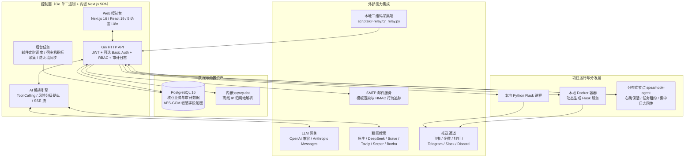

<p align="right">
  <a href="README.md">English</a> · <b>简体中文</b> · <a href="README.zh-TW.md">繁體中文</a> · <a href="README.ja.md">日本語</a> · <a href="README.ko.md">한국어</a>
</p>

<div align="center">
  <picture>
    <source media="(prefers-color-scheme: dark)" srcset="assets/readme/logo-dark.svg" />
    <source media="(prefers-color-scheme: light)" srcset="assets/readme/logo.svg" />
    
  </picture>

  <h1>Spearhook</h1>

  <p>
    
    
    
    
    
    
    
  </p>

  <p>面向授权安全演练与安全意识评估的一体化控制平台：基于 Go 单二进制控制面、内嵌 Next.js 控制台、分布式轻量 Agent 节点以及 AI 对话式编排引擎构建。</p>

  <p>
    <a href="https://spearhook.pages.dev/"><strong>在线演示（Live Demo）</strong></a> ·
    <a href="#法律声明">法律声明</a> ·
    <a href="#项目简介">项目简介</a> ·
    <a href="#核心能力">核心能力</a> ·
    <a href="#架构">架构</a> ·
    <a href="#快速开始">快速开始</a> ·
    <a href="#远程-agent">远程 Agent</a> ·
    <a href="#控制台">控制台</a> ·
    <a href="#常见问题faq">FAQ</a> ·
    <a href="#进阶文档索引">进阶文档</a>
  </p>
</div>

---

## 法律声明

> [!WARNING]
> **合规与授权声明**：本项目仅用于**已获得明确书面授权**的企业安全意识演练、红蓝对抗模拟与防御验证。请严格遵守所在国家或地区的法律法规，严禁将本工具用于任何未经授权的测试或非法活动。使用者需自行承担一切使用责任。

---

## 项目简介

Spearhook 将授权安全演练全生命周期中的**公开线索搜集、页面模板构建、多节点部署、邮件触达与追踪、事件回收与告警通知**整合到同一控制面中，并通过受控的 AI 工具调用（Tool Calling）能力降低重复性编排成本。

### 设计特点

- **单二进制交付**：前端经 Next.js 静态导出后通过 `go:embed` 直接打包进 Go 可执行文件，同时内嵌离线 IP 地理定位库（`assets/qqwry.dat`）与二维码中继客户端脚本包。
- **控制面与执行面解耦**：演练项目既可在控制面本机以 Docker 容器或本地 Flask 进程运行，也可下发至多台异地部署的 `spearhook-agent` 节点执行，运行日志与提交事件自动汇聚回控制面。
- **AI 原生但严格受控**：内置对话式运维助手，强制通过平台注册的白名单工具执行所有读写操作；高危动作（如正式群发邮件活动、导出提交记录）默认暂停并要求操作员在前端显式确认。
- **开箱即用的安全治理**：支持 `admin` / `operator` 双角色与资源归属隔离、AES-GCM 静态加密存储敏感凭据与密钥、只追加不可删除的审计日志以及宿主机级 IP 黑名单拦截。

### 技术栈

| 层级 | 核心技术 |
| --- | --- |
| 后端控制面 | Go 1.24、Gin、GORM、PostgreSQL 16、JWT、AES-GCM、chromedp、Docker SDK、gopsutil |
| 前端控制台 | Next.js 16（静态导出）、React 19、TypeScript 5、Tailwind CSS、Radix UI、Zustand、Recharts、i18next |
| 分布式节点 | Go 独立静态二进制（`cmd/spearhook-agent`），无外部运行时依赖 |
| 落地页运行时 | Python 3 + Flask + Flask-CORS（本地进程或 Docker 容器） |
| 二维码采集端 | Python 3 + `mss` + `Pillow` + `pyzbar` + `requests` |

### 目录结构

```text
spearhook_v2/
├── main.go                    # 控制面入口：配置自检、数据库迁移、路由注册与内嵌前端托管
├── config/                    # config.yaml 加载、安全项检查、PostgreSQL 连接池初始化
├── models/                    # GORM 数据模型与自动迁移（30+ 核心业务与审计表）
├── handlers/                  # REST API、SSE 事件流、AI 对话、项目/邮件/Agent/二维码处理器
├── middleware/                # JWT 鉴权、平台 Basic Auth、IP 黑名单拦截、操作审计中间件
├── platform/                  # 部署编排、Docker 构建、Agent 任务队列、宿主机指标与 IP 守护
├── chattools/                 # AI 工具注册表、风险分级确认策略、System Prompt 与内置 Playbooks
├── utils/                     # AES-GCM 加密、HTML 抓取/改写、邮件 HMAC 追踪、LLM/搜索客户端、防火墙同步
├── audit/                     # 审计日志写入封装
├── cmd/
│   ├── spearhook-agent/       # 分布式轻量执行节点
│   ├── generate-encryption-key/ # 256-bit 随机加密密钥生成工具
│   ├── reset-password/        # 管理员强密码重置工具
│   └── migrate-db/            # 历史 SQLite 数据库迁移至 PostgreSQL 工具
├── frontend/                  # Next.js 16 + React 19 前端工程（构建输出至 frontend/dist）
├── scripts/
│   ├── setup.sh               # Go 后端环境初始化脚本
│   ├── build-all.sh           # 前端打包 + 全平台（Linux/macOS/Windows）交叉编译脚本
│   ├── deploy.sh              # SSH 一键部署脚本（支持 binary 与 docker 模式）
│   └── qr-relay/              # 本地二维码屏幕采集与上传客户端
├── assets/                    # 内嵌离线 IP 归属地库（qqwry.dat）与品牌资源
├── docs/                      # 架构、部署与占位符进阶文档
├── Dockerfile                 # 多阶段构建（Node 22 → Go 1.24 → Alpine 3.20 + Chromium + Python/Flask）
├── docker-compose.yml         # PostgreSQL 16 + Spearhook 控制面编排文件
├── config.yaml.example        # 控制面配置示例
└── agent.yaml.example         # 分布式 Agent 配置示例
```

---

## 核心能力

- **AI 助手（`/chat`）**
  - 空会话内置 Playbook 快捷模板（克隆并部署、搜集联系信息、绑定推送通道），支持 SSE 逐 Token 流式输出。
  - 严格的三级风险控制：**只读工具**自动执行；**写入工具**通过平台流水线执行；**高危工具**（`send_mail_campaign`、`export_credentials`）强制暂停等待人工确认。
  - 支持长会话历史自动摘要压缩、调用轮次上限、请求频率与单用户日配额限制，并统计各 AI 配置的 Token 消耗。
- **页面库（`/workbench/page-builder`）**
  - 支持对目标页面进行静态抓取，遇到前端渲染（SPA）页面时自动回退至无头 Chromium（`chromedp`）渲染提取。
  - 支持上传本地 HTML 文件（最高 30 MB）并调用 AI 自动改写表单提交路径、补全静态资源绝对地址（兼容 OpenAI `chat/completions` 与 Anthropic `/messages`），通过 SSE 实时汇报处理阶段。
  - 支持落地页模板占位符，在项目构建/部署时自动替换：`{{SUBMIT_URL}}`、`{{REDIRECT_URL}}`、`{{QR_RELAY_URL}}`、`{{QR_RELAY_IMG}}`。
- **项目（`/projects`）**
  - 支持三种运行模式：**本地 Docker**、**本地 Flask** 以及 **分布式 Agent**（控制面在 `20000–30000` 端口段为每个节点自动分配不冲突端口）。
  - 支持自定义路由、上传挂载 SSL 证书启用 HTTPS、实时日志与健康检查；提交数据以只追加加密事件表（`CredentialSubmissionEvent`）为单一事实源，自动投影为账号与尝试视图，并关联 IP 归属地与邮件活动归因。
- **邮件（`/workbench/mail`、`/smtp-services`）**
  - 管理多套加密存储的 SMTP 发信档案（接口永不回显密码明文）与可复用邮件模板，支持立即群发与定时任务调度。
  - 支持收件人级个性化变量（`{{email}}`、`{{sig}}`、`{{v}}`、`{{click_url}}`、`{{open_pixel}}`、`{{landing_url}}`），每个活动自动生成独立追踪路径，通过 HMAC-SHA256 归因打开/点击/提交行为，并支持跳转域名白名单校验。
- **推送通道（`/robots`）**
  - 支持 **飞书、企业微信、钉钉、Telegram、Slack、Discord** 六大 Webhook 机器人，支持自定义通知语言、连通性测试、上下线开关以及完整的推送请求/响应日志。
- **QR 钓鱼 / 二维码实时中继（`/workbench/qr-phishing`）**
  - 控制面维护稳定的公开图片地址（`/q/:slug`），配合本地 Python 采集端（`scripts/qr-relay/qr_relay.py`）定时抓取并仅上传二维码图像帧与心跳。
  - 控制台支持 SSE 实时监控在线/过期状态、历史帧回溯与置顶、上传 Token / 访问 Slug 一键轮换。
- **信息搜集（`/workbench/info-gathering`）**
  - 异步执行目标公开线索搜集任务，支持 AI 原生联网搜索，或并发聚合多个独立搜索源（**DeepSeek Search、Brave、Tavily、Serper、博查 Bocha**），自动去重沉淀邮箱、电话与来源链接。
- **Agent（`/agents`）**
  - 轻量级独立 `spearhook-agent` 二进制，支持令牌注册、心跳保活、任务租约拉取与集中日志回传；支持单项目多节点与单节点多项目混布。
- **认证与角色（`/users`、`/audit-logs`）**
  - 支持平台前置 HTTP Basic Auth（默认开启）+ JWT 登录态 + `admin` / `operator` 角色与资源归属隔离；审计日志只追加、产品内不可删除。
- **安全加固与运维（`/`、`/ip-blacklist`）**
  - 仪表盘展示宿主机 CPU / 内存 / 磁盘 24 小时采样趋势（每 30 秒采集一次），访问日志按天轮转，内置离线 `qqwry.dat` 归属地库，并支持 **IP 黑名单**（Gin 应用层中间件 + Linux 宿主机 `iptables` 双层防护）。
  - 前端内置 **English、简体中文、繁體中文、日本語、한국어** 五种语言及纯静态离线演示模式。

---

## 架构



---

## 快速开始

### 环境要求

- **Docker 部署（推荐）**：Docker Engine 20.10+ 与 Docker Compose v2
- **源码运行 / 开发**：
  - Go `1.24+`、Node.js `22+`、PostgreSQL `16+`（控制面强制使用 PostgreSQL）
  - 可选：Chromium（SPA 渲染抓取）、Python 3 + `flask`/`flask-cors`/`requests`（本地 Flask 模式）、Docker Daemon（本地 Docker 模式）

### 方式一：Docker Compose 一键启动（推荐）

1. **准备配置文件并替换默认密钥**

```bash
cp config.yaml.example config.yaml
# 如需生成 256-bit 随机加密密钥：
go run ./cmd/generate-encryption-key
```

编辑 `config.yaml`，务必替换 `security.*` 下的全部示例占位密钥。

2. **创建 `.env` 并启动容器**

```env
POSTGRES_DB=spearhook
POSTGRES_USER=spearhook
POSTGRES_PASSWORD=请替换为高强度随机密码
TZ=Asia/Shanghai
```

```bash
docker compose up -d --build
```

3. **获取初始管理员密码**

首次启动会自动创建 `admin` 账号，并将随机初始密码写入 `./data/admin_password.txt`（权限 `0600`）：

```bash
cat ./data/admin_password.txt
```

浏览器访问 `http://<你的服务器IP>:8000` 即可登录。若 `platform_basic_auth_enabled: true`（默认），浏览器会先弹出 HTTP Basic Auth 验证框，输入同样的 `admin` 与初始密码即可进入。登录后建议及时修改密码并删除 `admin_password.txt`。

### 方式二：源码本地开发

```bash
# 1. 配置 config.yaml 中的 PostgreSQL DSN 与安全密钥
cp config.yaml.example config.yaml

# 2. 至少构建一次前端，供 go:embed 嵌入 frontend/dist
cd frontend && npm ci && npm run build && cd ..

# 3. 启动后端控制面（默认监听 :8000）
go run .

# 4. 可选：前端热更新开发服务器（监听 :8081）
cd frontend && npm run dev
```

健康检查接口：`GET /healthz`（存活）与 `GET /readyz`（数据库就绪）。

### 方式三：跨平台编译与 SSH 一键部署

```bash
# 前端打包 + 全平台（Linux/macOS/Windows）编译控制面与 Agent 至 release/
./scripts/build-all.sh

# SSH 一键部署（二进制 + systemd 模式）
DB_DSN='host=127.0.0.1 port=5432 user=spearhook password=xxx dbname=spearhook sslmode=disable' \
./scripts/deploy.sh binary <目标主机IP> root 22

# SSH 一键部署（Docker 镜像模式）
DB_DSN='host=127.0.0.1 port=5432 user=spearhook password=xxx dbname=spearhook sslmode=disable' \
INSTALL_DOCKER=1 ./scripts/deploy.sh docker <目标主机IP> root 22
```

### 首次登录后的标准演练流程

1. **配置系统底座**：在 **系统 → AI 配置** 添加并测试模型；按需在 **系统 → 搜索配置** 启用搜索源；在 **系统 → 邮件追踪** 填写外部可达的 `public_base_url` 与跳转域名白名单。
2. **配置发信与告警通道**：在 **SMTP 服务** 添加发信账号，在 **推送通道** 添加通知机器人。
3. **准备落地页模板**：在 **工作台 → 页面构建器** 克隆目标页面，或上传本地 HTML 由 AI 自动改写并入库。
4. **创建并运行演练项目**：在 **项目管理** 中选择页面与运行模式（本地 Docker / 本地 Flask / 远程 Agent），按需绑定机器人、HTTPS 证书或二维码中继。
5. **发起演练与复盘**：通过 **工作台 → 邮件演练** 或 **二维码中继** 开展演练（也可直接在 `/chat` 通过自然语言一键编排），并在项目详情、仪表盘与审计日志中复盘。

### 生产部署避坑清单

- **非交互式环境启动（Docker / systemd）必须先改默认密钥**：若 `config.yaml` 中 `security.*` 仍为空或示例默认值，启动时会弹出交互确认，无 TTY 环境下将直接中止启动。
- **本地 Docker 项目模式依赖基础镜像 `python:3.9-slim`**：内网或离线环境请提前在宿主机执行 `docker pull python:3.9-slim`。
- **反向代理需关闭缓冲以支持 SSE 实时流**：AI 对话、页面抓取改写与二维码状态监控均依赖 SSE。Nginx 参考配置：
  ```nginx
  location / {
      proxy_pass http://127.0.0.1:8000;
      proxy_http_version 1.1;
      proxy_set_header Host $host;
      proxy_set_header X-Real-IP $remote_addr;
      proxy_set_header X-Forwarded-For $proxy_add_x_forwarded_for;
      proxy_set_header X-Forwarded-Proto $scheme;
      proxy_buffering off;
      proxy_cache off;
      proxy_read_timeout 300s;
  }
  ```
- **macOS / Windows 下使用 `docker-compose.yml` 的网络差异**：`docker-compose.yml` 默认使用 `network_mode: host` 以适配 Linux 宿主机端口暴露。桌面版 Docker 建议改为显式 `ports: ["8000:8000"]`（并将 `SPEARHOOK_DB_DSN` 中的 `host` 指向 `postgres`），或使用源码运行。
- **妥善保管 `security.encryption_key`**：数据库内加密字段均依赖该密钥，**初始化后切勿随意更换**并做好离线备份。

### 核心配置说明（`config.yaml`）

AI 模型、搜索源与邮件追踪配置在首次启动后均可在控制台热更新；`config.yaml` 管理启动期核心参数：

| 配置项 | 说明 | 环境变量覆盖 |
| --- | --- | --- |
| `server.port` | 控制面 HTTP 监听端口（默认 `8000`） | — |
| `server.gin_mode` | `debug` / `release` / `test` | — |
| `database.dsn` | **必填**，PostgreSQL 连接字符串 | `SPEARHOOK_DB_DSN` |
| `database.path` | 数据目录基准路径（访问日志、产物与初始密码文件） | `SPEARHOOK_DB_PATH` |
| `security.encryption_key` | AES-GCM 静态加密主密钥（**初始化后切勿随意更换**） | — |
| `security.jwt_secret` | JWT 签名密钥 | — |
| `security.container_secret` | 落地页容器向控制面换取回调 Token 的共享密钥 | — |
| `security.agent_registration_token` | 远程 Agent 首次注册令牌（为空时回退至 `container_secret`） | — |
| `security.platform_basic_auth_enabled` | 是否启用平台前置 Basic Auth 保护（默认 `true`） | — |
| `chat.*` | 可选，配置 `max_tool_rounds`（`8`）、`rate_min_interval_ms`（`800`）、`daily_limit`（`200`）、`max_history_messages`（`40`） | — |
| `search.*` | 可选，首次启动种子到数据库的搜索源配置（`auto` / `deepseek` / `brave` / `tavily` / `serper` / `bocha`） | — |

> [!TIP]
> 无头浏览器克隆 SPA 页面时，可通过环境变量 `CHROME_PATH` 指定本机 Chromium / Chrome 路径（Docker 镜像内已预设 `/usr/bin/chromium`）。

---

## 远程 Agent

### 1. 部署 `spearhook-agent`

在远程执行节点准备 `agent.yaml`（参考 [agent.yaml.example](agent.yaml.example)）：

```yaml
server_url: http://<控制面地址>:8000
registration_token: <与控制面 security.agent_registration_token 一致>
name: node-hk-01                  # 可选，默认取主机名
work_dir: ./data/agent            # 存放 state.json 与 pending-logs.json
bind_host: 0.0.0.0                # 可选监听地址
advertise_host: <节点公网IP或域名>
heartbeat_interval: 30s
poll_interval: 3s
tags: ["edge", "region-a"]
```

启动 Agent：

```bash
./spearhook-agent -config agent.yaml
```

- **凭证与日志缓冲**：首次启动自动完成注册并将长期凭证写入 `work_dir/state.json`。控制面不可达时，访问日志写入本地 `pending-logs.json`，待恢复连接后自动补传。
- **提交实时代理**：表单提交数据直接实时转发至控制面（不设本地提交队列）；控制面不可达时，访客将收到 HTTP `502`。

### 2. 二维码实时采集端（`scripts/qr-relay`）

在控制台 **工作台 → 二维码中继** 创建通道并复制上传 Token，可直接从界面下载脚本包，或在 `scripts/qr-relay/` 目录运行：

```bash
cd scripts/qr-relay
cp config.example.yaml config.yaml
# 填写 platform_url 与 upload_token

pip install -r requirements.txt
# macOS 需额外安装底层库：brew install zbar
# Windows 建议使用预编译轮子：pip install --only-binary=:all: -r requirements.txt
# （Windows 下 libzbar-64.dll 需安装 VC++ 2013 x64 运行库）

# 可选：交互式框选屏幕物理像素区域并写入 config.yaml
python3 qr_relay.py --pick-region -c config.yaml

# 启动持续采集、去重上传与过期状态心跳
python3 qr_relay.py -c config.yaml
```

### 3. 内置运维 CLI（`cmd/`）

- **生成 256-bit 加密密钥**：`go run ./cmd/generate-encryption-key`
- **重置管理员密码**（生成 20 位强密码并写入 `data/admin_password.txt`）：`go run ./cmd/reset-password`
- **历史 SQLite 迁移至 PostgreSQL**（保留 ID 与加密密文，建议先加 `-dry-run` 预检）：
  ```bash
  go run ./cmd/migrate-db -sqlite ./data/fishing.db -postgres "host=127.0.0.1 port=5432 user=spearhook password=xxx dbname=spearhook sslmode=disable" -dry-run
  ```

---

## 控制台

内嵌 Next.js 16 单页控制台与后端 API 共享同一端口，核心模块如下：

- `/` — 仪表盘（运行项目、在线 Agent、活跃部署、当日事件及宿主机 24 小时资源趋势）
- `/chat` — AI 对话式编排工作台（Playbook 快捷模板与高危操作人工确认）
- `/workbench/page-builder`、`/workbench/mail`、`/workbench/info-gathering`、`/workbench/qr-phishing` — 演练工作台四大模块
- `/projects`、`/agents`、`/robots`、`/smtp-services`、`/ip-blacklist` — 项目、节点与运维资源管理
- `/users`、`/audit-logs`、`/ai-settings`、`/search-settings`、`/mail-tracking` — 管理员系统配置与合规审计

### 测试与前端演示构建

```bash
# 运行 Go 后端单元测试
go test ./...

# 运行前端工具函数与国际化字典测试
cd frontend && npm run test:helpers

# 构建纯静态只读演示站点（输出至 frontend/demo-dist）
cd frontend && npm run build:demo:root
```

只读在线演示地址：**[https://spearhook.pages.dev/](https://spearhook.pages.dev/)**（内置模拟数据，无需连接后端）。

---

## 常见问题（FAQ）

<details>
<summary><strong>Q1：打开页面时浏览器先弹出原生账号密码输入框（HTTP Basic Auth）？</strong></summary>

`config.yaml` 默认开启了 `security.platform_basic_auth_enabled: true` 作为外围保护。验证直接使用数据库中的控制台账号密码（首次登录输入 `admin` 与 `data/admin_password.txt` 中的初始密码）。若已在内网或网关层做好鉴权，可将其设为 `false` 后重启。

</details>

<details>
<summary><strong>Q2：忘记管理员密码怎么办？</strong></summary>

在项目目录执行 `go run ./cmd/reset-password`，工具会为 `admin` 重新生成 20 位强密码并写入 `data/admin_password.txt`。登录后修改密码并及时删除该文件。

</details>

<details>
<summary><strong>Q3：启动时出现 <code>Security configuration warning</code> 并在 Docker / systemd 下直接退出？</strong></summary>

说明 `config.yaml` 中的 `encryption_key`、`jwt_secret`、`container_secret` 或 `agent_registration_token` 仍为空或示例默认值。无 TTY 环境下安全确认无法交互会自动中止，请将上述密钥全部替换为随机长字符串后重启。

</details>

<details>
<summary><strong>Q4：克隆前端渲染（SPA）页面时报错或提示 Chromium 不可用？</strong></summary>

SPA 页面抓取依赖无头 Chromium（`chromedp`）。官方 Docker 镜像已内置 `/usr/bin/chromium`；源码或二进制部署请确保宿主机已安装 Chromium/Chrome，并通过 `CHROME_PATH` 指定可执行文件路径。

</details>

<details>
<summary><strong>Q5：邮件追踪链接指向 <code>127.0.0.1</code>，或者点击链接时提示跳转被拒绝？</strong></summary>

前往控制台 **系统 → 邮件追踪**，将 `public_base_url` 修改为外部可访问的控制面地址（含协议与端口），并将落地页域名加入允许跳转白名单（`allow_redirect_hosts`）。

</details>

<details>
<summary><strong>Q6：更换了 <code>security.encryption_key</code> 后，原有机器人 / SMTP / AI 配置异常？</strong></summary>

敏感字段使用 `security.encryption_key` 进行 AES-GCM 静态加密，更换密钥会导致历史密文无法解密。请恢复原密钥，或在控制台重新保存对应配置以使用新密钥重新加密。

</details>

---

## 进阶文档索引

| 文档 | 说明 |
| --- | --- |
| [docs/deployment.md](docs/deployment.md) | 生产环境一键部署（Docker / 单二进制）、升级与排障指南 |
| [docs/agent-deployment.md](docs/agent-deployment.md) | 远程 Agent 部署：systemd、Windows 服务与反向代理配置 |
| [docs/placeholders.zh.md](docs/placeholders.zh.md) | 落地页 HTML 与邮件模板占位符完整参考 |
| [docs/ai-native-architecture.md](docs/ai-native-architecture.md) | AI 原生编排架构设计（工具注册、SSE 流与执行边界） |
| [docs/ai-native-assessment.md](docs/ai-native-assessment.md) | AI Native 可行性评估与演进路径 |
| [docs/demo-hosting.md](docs/demo-hosting.md) | 只读演示站点在 Cloudflare Pages 上的托管指南 |
| [scripts/qr-relay/README.zh.md](scripts/qr-relay/README.zh.md) | 二维码本地截屏采集端详细使用说明 |

---

## 免责声明

Spearhook 仅面向获得明确书面授权的安全意识培训、内部演练与防御验证。严禁在未经授权的情况下对任何系统、账号或个人部署或使用本软件。使用者须独立承担遵守适用法律法规与组织合规要求的全部责任，项目作者及贡献者不对任何滥用行为承担责任。

本项目基于 [MIT License](LICENSE) 开源。
